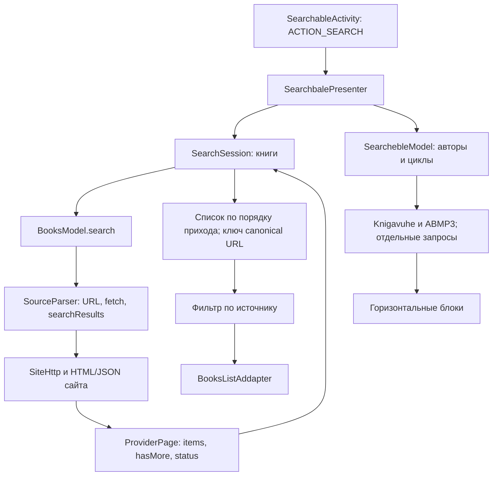
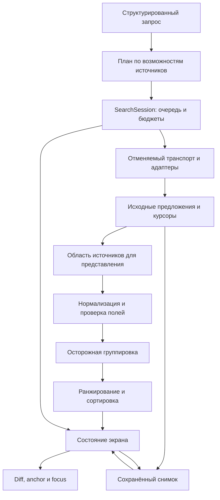

# Поиск аудиокниг: анализ и концепция развития

Дата: **1 ноября 2026 года**. Объект: `C:\work2000\AudioBooks`, рабочее дерево поверх коммита `a5359953afaa46e25e8549879191f415191af577`, приложение `8.0 / 103`, Java/XML, minSdk 24.

**Назначение документа:** объяснить ограничения существующего поиска и предложить согласованное изменение поведения, архитектуры и интерфейса. Это анализ и проект решения; перечисленные улучшения ещё не реализованы. Код приложения в рамках этой работы не изменялся.

## Содержание

1. [Рекомендуемая концепция](#1-рекомендуемая-концепция)
2. [Основание анализа и границы доказательств](#2-основание-анализа-и-границы-доказательств)
3. [Как устроен поиск сейчас](#3-как-устроен-поиск-сейчас)
4. [Проблемы и приоритеты](#4-проблемы-и-приоритеты)
5. [Пользовательские сценарии и семантика запроса](#5-пользовательские-сценарии-и-семантика-запроса)
6. [Релевантность и алгоритмы сравнения строк](#6-релевантность-и-алгоритмы-сравнения-строк)
7. [Группировка произведений, озвучек и источников](#7-группировка-произведений-озвучек-и-источников)
8. [Стратегии источников и зеркал](#8-стратегии-источников-и-зеркал)
9. [Скорость, отмена, таймауты и пагинация](#9-скорость-отмена-таймауты-и-пагинация)
10. [Кеш и восстановление последнего поиска](#10-кеш-и-восстановление-последнего-поиска)
11. [Проект интерфейса](#11-проект-интерфейса)
12. [Архитектура и план внедрения](#12-архитектура-и-план-внедрения)
13. [Проверка качества и критерии приёмки](#13-проверка-качества-и-критерии-приёмки)
14. [Решения, которые не стоит принимать без измерений](#14-решения-которые-не-стоит-принимать-без-измерений)
15. [Источники и навигация по коду](#15-источники-и-навигация-по-коду)

## 1. Рекомендуемая концепция

Поиск следует развивать в **единый поиск произведений и их доступных озвучек**, в котором сетевые источники остаются видимыми и управляемыми. Пользователь формулирует намерение — название, автор, чтец, цикл или их сочетание — и получает понятную выдачу с объяснимым порядком, вариантами исполнения и честным указанием полноты поиска.

Существующую основу можно сохранить: `Provider`, адаптеры `SourceParser`, `SearchSession`, RxJava, Moxy и Java/XML. Перевод на другую технологию интерфейса, развёртывание Solr или полная перепись приложения для этой задачи не нужны.

Предлагаются следующие опорные решения:

| Решение | Польза для слушателя | Технический смысл |
|---|---|---|
| Обычная строка плюс раскрываемые поля | Можно быстро искать «Мастер и Маргарита» или точно задать автора и чтеца | Структурированный запрос; индивидуальный план получения кандидатов для каждого сайта |
| По умолчанию — релевантность | Нужная книга появляется выше случайных совпадений | Точное совпадение, покрытие слов и полей, затем ограниченная коррекция опечаток |
| Во «Все» — объединение произведений с сохранением вариантов | Десять сайтов не занимают десять одинаковых карточек; другие озвучки не теряются | Разделение произведения, записи и ссылки источника; осторожное объединение |
| Локальные сортировка и фильтры | Можно изменить порядок без нового сетевого поиска | Преобразование уже загруженного набора; видимый признак неполной выдачи |
| Статус каждого источника | Понятно, где найдено, где ещё идёт поиск и что можно повторить | События состояния, раздельные ошибки, отдельный повтор источника |
| Последний поиск сохраняется на диск | После возвращения можно продолжить выбор с того же места | Версионированный снимок запроса, результатов, состояния и позиции |
| Зеркала — управляемые альтернативы | Повышение доступности без бессмысленного дублирования запросов | Проверенные группы каталогов, отдельные адреса и курсоры, ограниченный failover |
| Поиск отдаёт результат постепенно | Можно выбирать книгу, пока медленный сайт ещё отвечает | Независимые операции, бюджеты, реальная отмена, сохранение позиции списка |

**Главные ограничения, которые нельзя скрывать дизайном:**

- Постобработка сортирует и фильтрует только то, что источники вернули. Она не исправляет пропуски серверного поиска сама по себе.
- «Все» означает все выбранные источники и уже полученные результаты. Это не гарантия обхода всех страниц всех каталогов.
- Одинаковые название и автор ещё не означают одинаковую аудиозапись. У чтеца могут существовать полная и сокращённая версии.
- Число `87/100` может быть оценкой алгоритма; оно не означает «вероятность правильного ответа 87%».
- Уменьшение параллелизма может снизить нагрузку, но увеличить время ожидания. Конкретный оптимум требует измерений.

Сначала стоит устранить ошибки состояния, сделать статусы и сохранение результатов. Затем ввести сортировку и осторожную группировку. Расширенный запрос и адаптивные сетевые стратегии развивать поверх этой проверяемой основы.

## 2. Основание анализа и границы доказательств

### 2.1. Что изучено

Изучены основной экран поиска, presenter, модель поисковых подсказок, оркестрация `SearchSession`, реестр и настройки источников, HTTP-слой, контракты и реализации адаптеров, модели книг, списки результатов, обычная и TV-разметка, тесты и сохранённые ответы сайтов. Отдельно сопоставлены поиск книг, поиск людей, блоки авторов/циклов и «На других сайтах»: это разные существующие пути выполнения.

Прочитаны [руководство проекта](docs/howto.md), [план развития источников](tasks/plan.md), [список задач](tasks/todo.md), сведения о машине в `C:\work\audiobook\readme.md` и материалы `C:\work\audiobook\notes\`. Учтены [правила рабочего окружения](CLAUDE.md).

Параллельные независимые разборы выполнены моделями GPT-6 и GPT-6.1 с максимальным доступным reasoning: стратегия источников, интерфейс/состояния, алгоритмы ранжирования. Их предложения сопоставлены с кодом и объединены здесь; разногласия разрешены через явные ограничения и критерии проверки.

В исходном рабочем дереве уже были изменения `Provider.java`, `ProviderTest.java`, `docs/howto.md` и неотслеживаемая `.claude/`. Анализ учитывает текущее содержимое этих файлов, в том числе новые отношения зеркал. Это не описание исключительно коммита HEAD.

### 2.2. Что проверено исполнением

Выполнен один целевой прогон существующих JVM-тестов:

```powershell
powershell -NoProfile -File C:/Users/user/AppData/Local/audiobook-audit-tools/g.ps1 C:/work2000/AudioBooks :app:testDebugUnitTest --tests 'com.fanok.audiobooks.search.*' --tests 'com.fanok.audiobooks.presenter.SearchbalePresenterTest' --tests 'com.fanok.audiobooks.net.SiteHttpTest'
```

Результат: **92 теста, 12 наборов, 0 failures, 0 errors, 0 skipped; BUILD SUCCESSFUL**. Отчёты: `app/build/test-results/testDebugUnitTest/`, журнал: `build/g.log`. Проверены существующие контракты сессии, URL, настроек источников, классификации HTTP и смежной логики. Это не полный прогон всех тестов адаптеров и не тестирование будущих функций.

Эмулятор, APK и живые поисковые запросы к книжным сайтам в этой работе не запускались. Поэтому:

- UI-выводы основаны на коде, XML и generated binding; это не визуальная проверка актуального экрана на устройстве.
- Не утверждается, что измерены реальные p50/p95 сайтов, найден оптимальный timeout или воспроизведена задержка конкретной многословной фразы.
- Снимки HTML/JSON и комментарии адаптеров подтверждают предусмотренный протокол, но не сегодняшнюю доступность сайта.
- Все предлагаемые бюджеты, TTL, пороги нечёткого сравнения и показатели скорости ниже — **стартовые параметры эксперимента**, если прямо не указано, что это существующая константа.

### 2.3. Как читать старую документацию

Старые документы полезны как история решений, но местами уже отстают от кода. В частности, сейчас в `Provider` **23 записи**, одновременно активны максимум **13**, все имеют адаптер; основной внешний лимит поиска в presenter — **20 секунд**, а не 10 секунд из прежнего плана. Для медленных источников он увеличивается. Старый каталог `C:\work\audiobook` описывает другой applicationId; здесь актуален `com.fanok.books`.

Ниже слова **«подтверждено»** относятся к исходному коду или выполненным тестам; **«риск»** — к выводу из кода без воспроизведения; **«предлагается»** — к будущему поведению.

## 3. Как устроен поиск сейчас

### 3.1. Поток данных



Поиск авторов/чтецов в отдельных разделах использует другую `SearchSession<GenrePOJO>` и **текущий источник**, а не многополевой поиск книг по всем площадкам.

### 3.2. Что уже сделано правильно

1. Источники отдают результаты независимо: пользователь не обязан ждать весь набор, чтобы увидеть первую книгу.
2. Новый запрос увеличивает `generation`, отменяет подписки предыдущего и не принимает его поздние ответы.
3. Курсор следующей страницы хранится отдельно для каждого источника; ошибка сохраняет страницу для повторной попытки.
4. `ProviderPage` различает `OK`, `EMPTY`, `ERROR`, `TIMEOUT`, `BLOCKED`; ошибка не должна изображаться пустой выдачей.
5. `ProviderPage.of(..., rawCards)` сохраняет возможность продолжения, если карточки были, но все отфильтрованы парсером.
6. `SearchUrls` делегирует схему адреса адаптеру и кодирует строку запроса, не подставляя номер страницы в произвольные цифры URL.
7. `SiteHttp` задаёт ограничения тела ответа, распознаёт известные challenge-страницы, учитывает HTTP-ошибки и cookies.
8. Есть тесты отмены, поздних ответов, повтора ошибок, страниц и повторяющейся последней страницы.

Эти свойства нужно сохранить и расширить, а не заменить одним новым «умным поиском» без их гарантий.

### 3.3. Текущие ограничения оркестрации

`SearchSession.MAX_PARALLEL = 13`; `Sources.MAX_ACTIVE = 13`. Основной поиск может сразу занять 13 операций. Запросы блоков авторов/циклов и других подсистем в этот предел не входят.

Внешний timeout книги равен `max(20, provider.requestSeconds())`, где `requestSeconds()` — целые секунды `parser.timeoutMs()` плюс 5. В обычном случае HTTP-настройка составляет 10 секунд, внешний лимит — 20; у Audioknigi.fun — 25/30; у Audioboo — 30/35; у Bookish — 40/45. Внешний лимит ограничивает всю операцию, HTTP-настройка относится к запросу транспорта; это разные величины. Цепочка из нескольких запросов не получает автоматически единый корректный бюджет каждого шага.

После завершения первого прохода для источников с `EMPTY` запускается ещё один запрос с изменённым регистром. Он ждёт завершения всего первого прохода. Даже сайт, быстро ответивший «пусто», может долго ждать повторной попытки из-за другого сайта. Это объяснимая по коду дополнительная задержка, но её реальный вклад ещё нужно измерить.

`loadNext()` запрещён, пока остаётся хотя бы одна незавершённая операция текущего прохода. После этого загружаются следующие страницы **всех** неупавших источников с продолжением. Выбор вкладки одного сайта меняет представление, но не область следующего сетевого прохода.

### 3.4. Данные и сохранение

`BookPOJO` хранит название, автора, чтеца, цикл, жанр, время и ссылки, но многие значения nullable, а часть числовых характеристик представлена строками. Поле `reting` не гарантирует единую семантику: в разных путях это могут быть разные показатели. Оно непригодно для честного общего рейтинга источников без нормализации смысла.

Список книг сохраняется в памяти presenter. `SearchRecentSuggestions.saveRecentQuery()` сохраняет текст в истории, **не результаты**. В Room сейчас нет сущности снимка поиска. История запросов, история прослушивания, HTTP-кеш и сохранение поисковой сессии — разные задачи.

`SourceHealth` хранит результат проверки **первой страницы каталога**, а не успешность текущего поискового запроса. Эти данные полезны для выбора очередности, но не должны окрашивать вкладку поиска в зелёный как доказательство успешного поиска.

## 4. Проблемы и приоритеты

Обозначения: **P0** — исправить до расширения функционала; **P1** — основной пользовательский результат; **P2** — следующий этап после измерений. Приоритет здесь относится к этой инициативе, а не ко всем задачам приложения.

| № | Приоритет и основание | Проблема | Последствие и направление изменения |
|---|---|---|---|
| F01 | P0, подтверждено статически | `SearchableActivity:174` безусловно обращается к `retrySources`; TV-разметка этого элемента не содержит | При выборе TV-layout ожидается NPE в `onCreate`. Generated binding отмечает поле nullable. Выровнять контракт вариантов layout, проверить также `showSourcesFailed:448` |
| F02 | P0, вывод из lifecycle-кода | При process recreation создаётся новый presenter, но `handleIntent()` пропускается при ненулевом `savedInstanceState` | Нет источника восстановления запроса и результатов. Нужен снимок на диске и сохранённый идентификатор сессии |
| F03 | P0, подтверждено | `FilterAdapter.selected` вновь равен 0, тогда как presenter может сохранить фильтр | После пересоздания экран способен показывать «Все» выбранным при списке отдельного сайта. Состояние выбора должно приходить из одной модели |
| F04 | P0, подтверждено | `updateNotFound()` проверяет общий список, а не отфильтрованный | Пустая вкладка отдельного источника может остаться без сообщения. Считать состояние для выбранной области |
| F05 | P1, подтверждено | Дедупликация — только `Url.canonical(book.getUrl())` | Одна книга с разных сайтов повторяется; нужны группы произведений с сохранением всех вариантов |
| F06 | P1, подтверждено | Выдача идёт по порядку прихода | Быстрый слабый результат оказывается выше точного. Нужен локальный предсказуемый ranker |
| F07 | P1, подтверждено | Нет общей модели полей и локальных сортировок поиска | Нельзя выразить «этот автор + этот чтец», быстро отсортировать загруженное |
| F08 | P1, подтверждено | `statuses()` не передаётся в UI как поток состояний; callback элементов вызывается только при добавлении книг | Завершение пустого или ошибочного источника не даёт нормального независимого статуса вкладки |
| F09 | P1, подтверждено | Ошибки chips превращаются в пустой `SearcheblPOJO` | Пользователь не различает «циклы не найдены» и «поиск циклов не удался» |
| F10 | P1, подтверждено | `loadNext()` и `retryFailed()` ждут общий `pending == 0` | Медленный источник задерживает продолжение и повтор остальных |
| F11 | P1, подтверждено | Общий fallback регистра после барьера всех сайтов | Добавляет второй проход без доказанной пользы для каждого источника; заменить профилем конкретного сайта |
| F12 | P1, риск транспорта | `Single.fromCallable`/dispose не даёт явного handle отмены HTTP в `SiteHttp` | UI может уже не принимать ответ, но реальная сеть/парсинг не доказаны завершёнными; нужен проверяемый контракт отмены |
| F13 | P1, подтверждено | Knigavuhe отдельно загружается для книг и chips; на некоторых сайтах есть внутренние дополнительные запросы | Повторная работа и непредсказуемый бюджет; совместное использование одного ответа и учёт всех физических запросов |
| F14 | P1, подтверждено | `SearchSession.apply()` останавливает источник по отсутствию новых глобальных ключей | При переносе сюда ключа произведения можно потерять следующие страницы. Пагинация должна опираться на источник, не на UI-группы |
| F15 | P2, подтверждено как ограничение | Списки копируются и проходят через `notifyDataSetChanged()` | На большой выдаче возможны лишние перерисовки; измерить и перейти к diff со стабильными ID |
| F16 | P1, подтверждено | Реестр зеркал существует в рабочем дереве, но основной поиск обходит источники по отдельности | Метаданные родства ещё не дают failover, экономию запросов или идентичность книг |

Ни F12, ни F15 не следует выдавать за измеренную утечку ресурсов или доказанное торможение устройства. Это конкретные места для инструментальной проверки.

## 5. Пользовательские сценарии и семантика запроса

### 5.1. Что пользователь пытается сделать

| Сценарий | Ожидаемое поведение |
|---|---|
| Знаю точное название | Точное произведение выше продолжений, обзоров и частичных совпадений; видно автора и варианты озвучки |
| Помню часть названия или ошибся в букве | Совпадения всех слов выше совпадений одного; исправление не подменяет исходный запрос молча |
| Ищу автора | Книги этого автора; при неоднозначности — выбор человека, а не совпадения фамилии в описании |
| Хочу слушать определённого чтеца | Озвучки этого чтеца, в том числе разных авторов; неизвестный чтец не считается подтверждённым совпадением |
| Ищу цикл | Отдельная сущность цикла, доступные тома и их порядок; книга с похожим названием не маскируется под цикл |
| Название + автор + чтец | Все условия применяются к одному совместимому варианту, а не к разным карточкам одной группы |
| Хочу сравнить озвучки | В группе видны чтецы, известная длительность, полная/сокращённая версия и источники |
| Один сайт не отвечает | Остальные результаты доступны; понятная кнопка повтора именно этого сайта |
| Вернулся после открытия книги или перезапуска | Тот же запрос, вкладка, сортировка, раскрытая группа и позиция; никаких обязательных повторных запросов |
| Пользуюсь ТВ/крупным шрифтом/TalkBack | Видимый фокус, короткая логичная навигация, читаемые статусы без зависимости только от цвета |

### 5.2. Два уровня ввода

**Обычный режим:** одна строка и компактный выбор области: «Везде», «Название», «Автор», «Чтец», «Цикл». По умолчанию «Везде» означает поиск по доступным метаданным книги: названию, автору, чтецу, циклу. Поиск по полному описанию — отдельная будущая опция: он дороже и даёт больше случайных совпадений.

**Расширенный режим:** раскрываемая панель/диалог с отдельными полями «Название», «Автор», «Чтец», «Цикл». Заполненные поля соединяются **И**. Пример: `Автор = Стругацкие`, `Название = Пикник на обочине`, `Чтец = …`.

Если пользователь выбирает несколько областей для одной общей строки, семантика другая: `строка в названии ИЛИ в авторе`. Это нельзя смешивать с отдельными заполненными полями. На первом этапе лучше оставить одиночный переключатель области плюс расширенные поля: меньше неоднозначности и лишних контролов.

При переходе в расширенный режим текст переносится в выбранное поле; строка режима «Везде» остаётся отдельным общим условием либо явно предлагается её распределить. Нельзя незаметно продублировать её во все поля и получить чрезмерно строгий запрос. Свёрнутая панель показывает чипы условий, например `Автор: Булгаков ×` и `Название: Мастер и Маргарита ×`.

### 5.3. Договор о совпадении

- Указанное поле ограничивает место совпадения. Фамилия в названии книги не подтверждает автора.
- Внутри поля базово требуются все значимые слова с учётом разрешённых нормализаций. Порядок повышает релевантность, но не всегда является жёстким условием.
- Переключатель «Точная фраза» означает последовательность слов в указанном поле. Он не означает полное равенство всей строки названия; при необходимости «Название целиком» — отдельный режим.
- Числа, номера томов и частей проверяются строго. «Том 2» нельзя автоматически исправить на «Том 3».
- В расширенном режиме обязательные поля — ограничения, а не просто бонусы ранжирования. Неподходящий чтец не компенсируется идеальным названием.
- Обычный поиск может показывать блок «Похожие результаты», если нет полного совпадения. Расширенные условия не ослабляются без явного действия «Расширить поиск».
- Поиск не запускается для строки из пробелов. Короткие осмысленные запросы вроде «Оно», «Мы», «It» разрешены, но без агрессивного fuzzy.

### 5.4. Неизвестное поле — третье состояние

Для каждого обязательного поля результат проверки: `MATCH`, `MISMATCH`, `UNKNOWN`.

| Результат проверки | Представление |
|---|---|
| Все условия подтверждены | Основная выдача |
| Хотя бы одно известно и не подходит | Исключить из строгой выдачи |
| Противоречий нет, часть полей отсутствует | Отдельно: «Есть ещё кандидаты, у которых не указан чтец/цикл» |

По умолчанию строгий фильтр не показывает `UNKNOWN` как подтверждённое совпадение. Пользователь может раскрыть кандидатов или выбрать «Уточнить метаданные». Ограниченная догрузка деталей только для верхних/видимых кандидатов допустима; массовая загрузка страницы каждой книги создаст N+1 и уничтожит выигрыш скорости.

**Важный пример:** у группы есть запись A с подходящим автором, но другим чтецом, и запись B с нужным чтецом, но конфликтующим автором. Группа не проходит `автор И чтец`, если нет хотя бы одного варианта, который удовлетворяет условиям целиком.

### 5.5. Получение кандидатов и локальный фильтр

Если сайт ищет только по названию, передавать ему `название + автор + чтец` обычно неправильно: сайт может вернуть ноль. Планировщик должен выбрать допустимый запрос, а остальные поля проверить локально. Для поиска только по автору, если title-only endpoint не ищет автора, нужны поиск людей → страница автора → его книги либо другой подтверждённый endpoint.

Если подходящего пути нет, показывать «Поиск по чтецу у этого источника ограничен» и предложить работу по уже сохранённым данным. Нельзя обещать полный поиск по автору через простую постфильтрацию результатов title-only endpoint.

Формальный `SearchRequest` должен сохранять исходный ввод, выбранные поля, режим фразы/опечаток и выбранные источники. Сортировка, раскрытые группы и позиция — состояние представления, а не причина новых сетевых запросов.

### 5.6. Циклы и люди как отдельные результаты

Результат «Цикл» должен иметь собственный тип, название, известного автора/авторов и ссылки на страницы цикла. Он не равен книге, у которой похожее название. Использовать найденные поисковые блоки сайта, подтверждённый поиск сущностей, ссылки/названия циклов в возвращённых карточках и сохранённые метаданные. Последние два пути дают только частичное покрытие и должны так обозначаться. Не выводить название цикла автоматически из общего префикса нескольких книг.

При открытии цикла загружать его список через имеющиеся возможности адаптера; сохранять различие произведения/тома и его озвучек. Если порядок томов известен — показывать его; если нет — исходный порядок сайта и отметку «Номер не указан». Не объявлять цикл полным по числу уже полученных карточек. Совпадение названия цикла у разных авторов не является достаточным основанием объединить ссылки.

Аналогично карточка «Автор» или «Чтец» — это человек с ролью и источниками, а не произвольная строка. Выбор такой карточки может заполнить поле запроса или открыть книги этой сущности; подпись действия должна различать эти варианты. Отсутствие отдельного результата человека/цикла не доказывает отсутствие подходящих книг. Для первой версии достаточно компактной секции связанных сущностей; отдельные вкладки «Книги / Циклы / Люди» добавлять, когда есть достаточное покрытие и проверенное поведение каждого типа.

## 6. Релевантность и алгоритмы сравнения строк

### 6.1. Почему одного similarity недостаточно

Сравнение полного запроса с одной склеенной строкой `название + автор + чтец + цикл` штрафует полезные дополнительные метаданные и плохо объясняет результат. Книга с правильным названием и длинным именем чтеца может получить меньшую похожесть, чем короткая нерелевантная карточка. Обычный Levenshtein чувствителен к перестановке слов, а совпадение автора в аннотации не доказывает авторство.

Нужен **ранжировщик с учётом полей**, использующий строковые алгоритмы как отдельные признаки. Solr/Lucene здесь полезны как ориентир по работе с термами и релевантностью, а не как обещание «взять одну формулу и получить тот же поиск».

BM25 использует частоты терминов, насыщение частоты и нормализацию длины документа относительно коллекции. Неполные страницы разных сайтов не дают стабильной статистики полного каталога. Встраивать пересчитываемый BM25 по текущему прибывающему набору на первом этапе не рекомендуется: порядок будет зависеть от состава ответивших сайтов. [Lucene BM25Similarity](https://lucene.apache.org/core/9_12_3/core/org/apache/lucene/search/similarities/BM25Similarity.html).

### 6.2. Выбор из java-string-similarity

Проект уже написан на Java. Поэтому «портирование на язык проекта» не требуется: разумнее сначала проверить закреплённую зависимость `info.debatty:java-string-similarity:2.0.0` и использовать нужные классы. Копирование небольшого алгоритма в проект допустимо только при конкретной причине — например, требуется ограничение памяти/ранний выход, которого нет в выбранной реализации, — с сохранением происхождения, тестов и требуемых уведомлений.

| Алгоритм | Где полезен | Почему не делать единственным критерием |
|---|---|---|
| Levenshtein / NormalizedLevenshtein | Небольшие опечатки в отдельном слове; понятная цена вставки, удаления, замены | Перестановка соседних букв стоит иначе, чем пользователь обычно воспринимает ошибку; сравнение длинных фраз малоинформативно |
| **Optimal String Alignment (OSA)** | Рекомендуемый исходный fuzzy-признак для отдельных достаточно длинных слов; учитывает соседнюю перестановку букв | Это ограниченный вариант Damerau, не произвольная перестановка слов; реализация требует ограничений длины |
| Damerau | Альтернатива OSA для экспериментального сравнения на размеченных примерах | Более широкая модель преобразований не гарантирует лучшую выдачу |
| Jaro–Winkler | Дополнительный сигнал для некоторых вариантов имён | Бонус общего начала может чрезмерно сближать разные фамилии; не использовать как доказательство идентичности человека |
| Sørensen–Dice / Jaccard по n-граммам | Быстрый грубый отбор похожих длинных названий, поиск возможных дублей | Слабее учитывает порядок; короткие строки и номера частей требуют отдельного обращения |
| Cosine по профилям n-грамм | Ещё один сравниваемый признак на большом наборе | Сам по себе не знает ни автора, ни чтеца, ни обязательных условий |
| LCS / MetricLCS и другие | Только если измерения покажут полезный отдельный сценарий | Добавляют признаки и настройку без очевидной необходимости для первого выпуска |

**Предпочтение для первой версии:** точные нормализованные признаки + покрытие токенов/фраз + OSA для ограниченных опечаток. Dice оставить кандидатом для последующей проверки похожих названий. Не подключать одновременно все метрики и не усреднять их без проверяемого смысла. Описание алгоритмов: [java-string-similarity](https://github.com/tdebatty/java-string-similarity#overview).

OSA в рассмотренной версии работает по UTF-16 `char`, выделяет матрицу `O(m × n)` и не принимает `null`. Поэтому сравнивать короткие нормализованные токены, ограничивать длины и число кандидатов, не запускать попарное сравнение всех описаний. У Lucene fuzzy применяется к термам и имеет собственные ограничения расстояния; это не готовое обоснование одного порога для любых русских фраз. [OSA v2.0.0](https://github.com/tdebatty/java-string-similarity/blob/v2.0.0/src/main/java/info/debatty/java/stringsimilarity/OptimalStringAlignment.java), [Lucene FuzzyQuery](https://lucene.apache.org/core/9_3_0/core/org/apache/lucene/search/FuzzyQuery.html).

POM библиотеки указывает Java 8 и зависимость `jcip-annotations`; совместимость с конфигурацией приложения выглядит реалистично, но должна быть проверена разрешением зависимостей и release/R8-сборкой. В репозитории указана MIT-лицензия: при заимствовании/распространении сохранить применимые copyright/license notices, отдельно проверить транзитивные зависимости. Это задача интеграции, а не повод переписывать алгоритм по памяти. [POM v2.0.0](https://github.com/tdebatty/java-string-similarity/blob/v2.0.0/pom.xml), [репозиторий и лицензия](https://github.com/tdebatty/java-string-similarity).

### 6.3. Нормализация русского текста

Хранить исходный текст для отображения и отдельную нормализованную форму для сравнения:

1. Unicode NFC; преобразование регистра через `Locale.ROOT`.
2. Сведение вариантов пробелов, включая неразрывные, к обычным; trim; схлопывание повторов.
3. `ё → е` в поисковой форме как явное продуктовое правило. Сам Unicode NFC этого не делает.
4. Разумная унификация кавычек/тире и разбиение по Unicode-категориям букв/цифр. Сохранять исходные границы и последовательность слов для проверки фразы.
5. Не удалять числа и маркеры частей. Извлекать «том 2», «книга II» в отдельные признаки только при уверенном распознавании; неоднозначное исходное значение сохранять.
6. Инициалы, «Фамилия Имя»/«Имя Фамилия», дефисы имён обрабатывать отдельными правилами сравнения людей. Эти правила не превращают однофамильцев в одного человека.
7. Отдельные подтверждённые варианты имён можно хранить в маленьком версионируемом словаре. Не строить универсальную идентификацию людей по перестановке токенов.

Не удалять все диакритические знаки: это может сблизить `й` и `и`. Не удалять глобально «короткие незначимые слова»: «И никого не стало» — полноценное название, а «Мы» — полноценный запрос. Транслитерацию, исправление раскладки и русский stemming вводить как объяснимое расширение, если примеры покажут пользу; исходный запрос остаётся видимым. [Unicode normalization](https://unicode.org/reports/tr15/), [Lucene Russian analysis](https://lucene.apache.org/core/8_10_1/analyzers-common/org/apache/lucene/analysis/ru/package-summary.html).

### 6.4. Конкретная модель ранжирования

Сначала применить обязательные условия и существующие ограничения контента. Затем для каждого кандидата вычислить неизменяемый на данный момент ключ сортировки:

```text
matchTier
→ coverage всех требуемых слов/полей
→ качество совпадений внутри выбранных полей
→ порядок и близость слов
→ количество/стоимость допустимых опечаток
→ нормализованное название и автор
→ постоянный providerId + sourceItemKey
```

Сортировка лексикографическая: лучший уровень всегда важнее суммы слабых бонусов следующего уровня. Рабочая стартовая шкала:

| Уровень | Смысл |
|---|---|
| A | Полное нормализованное совпадение целевого поля; в расширенном режиме — полное нормализованное совпадение каждого обязательного поля |
| B | Точная непрерывная фраза внутри целевого поля |
| C | Все слова присутствуют; допускается иной порядок, а в режиме «Везде» — распределение по допустимым полям |
| D | Все слова покрыты с допустимым префиксом последнего слова либо ограниченной опечаткой |
| E | Только часть запроса подтверждена; показывать как похожие результаты, когда такой режим разрешён |

Префикс относится к поиску, а не к идентичности книги. При обязательном режиме точной фразы уровень D не проходит строгий фильтр. Для запроса по автору/чтецу главным становится указанное поле; универсальное правило «название всегда важнее» здесь неверно.

Для расширенного запроса общий уровень определяется худшим уровнем обязательного поля; затем сравнивается качество остальных. Все поля, удовлетворённые только через допустимые опечатки, не становятся уровнем A. Несовпадающее обязательное поле исключает кандидата из строгой выдачи; unknown сохраняется в отдельном наборе для уточнения.

Разделить бинарное покрытие токенов — долю слов, которым найдено допустимое соответствие, — и качество этих соответствий: exact даёт 1, fuzzy меньше 1 согласно расстоянию и длине. Одно слово карточки не должно подтверждать несколько разных слов запроса. Для короткого ограниченного набора токенов выбирать однозначное сопоставление с наибольшим числом допустимых пар, затем с наибольшим качеством и детерминированным разрешением равенства. Наивный жадный выбор может упустить хорошее сочетание; его нельзя объявлять оптимальным. Повторяющиеся слова и неоднозначные пары включить в тесты. Для многопольного AND нет усреднения, скрывающего провал обязательного поля.

Начальная гипотеза ограничений fuzzy: не исправлять числовые токены и слова длиной до 3 букв; для более длинных сначала пробовать расстояние 1; расстояние 2 разрешать только для длинных слов после оценки ложных совпадений. Конкретные границы длины и нормированные пороги выбрать на корпусе запросов. Ни общий фиксированный `similarity > 0.7`, ни порог из примера другой библиотеки не считать доказанно подходящими.

Для общего текста важен пример `Булгаков Мастер Маргарита`: все слова могут быть покрыты автором и названием. Для `сердце собачье` должна сработать перестановка **слов**, а не OSA по всей фразе. Для `собачье серцде` — ограниченная перестановка **букв** в токене.

### 6.5. Оценка, объяснение и стабильность

По умолчанию показывать короткое объяснение: «Совпали название и автор», «Похожее название», «Чтец не указан». Процент соответствия не обязателен для сортировки. Если он всё же нужен, использовать подпись **«Оценка соответствия: 87/100»**, явно определённую шкалу и не смешивать её с рейтингом или процентом прослушивания.

Не нормировать оценки через текущие min/max выдачи: при приходе нового сайта старые числа изменятся. Не пересчитывать частотные веса из каждой новой порции. Ключ зависит от запроса, метаданных кандидата и версии правил; изменение метаданных допускает контролируемый пересчёт.

Компаратор должен быть транзитивным и детерминированным. Нельзя сравнивать два элемента через правило «если их similarity почти одинаков, считать равными» или использовать fuzzy-сходство пары как отношение порядка. Использовать последовательность обычных сравнений фиксированных признаков. [Java Comparator contract](https://docs.oracle.com/javase/8/docs/api/java/util/Comparator.html).

Нормализацию и ranking выполнять вне main thread, кешировать нормализованные поля. Публиковать результат только для актуальных `generation` и `revision`: поздний расчёт сортировки старой версии не должен затереть новую выдачу. Android отдельно требует выносить длительную работу из UI-потока. [Android threading](https://developer.android.com/topic/performance/threads).

### 6.6. Как оценивать качество

Сравнить текущий порядок прихода с предложенным порядком на одном и том же наборе кандидатов. Это измеряет выигрыш ранжирования. Отдельно сравнить новый retrieval-план с текущими запросами к сайтам: это измеряет полноту получения кандидатов. Смешивание двух экспериментов скроет причину улучшения или регрессии.

Если сайт не вернул книгу с опечаткой, локальный fuzzy её не найдёт. Тогда возможен второй ограниченный запрос к источнику, исправление, подтверждённое локальным словарём, или поиск среди ранее сохранённых метаданных. «Похожие результаты в кеше» должны быть помечены отдельно от свежих ответов сайтов.

## 7. Группировка произведений, озвучек и источников

### 7.1. Разделить три уровня

| Уровень | Пример | Что сохраняется |
|---|---|---|
| Произведение | «Собачье сердце», Михаил Булгаков | Название, авторы, значимые признаки части/издания, группа вариантов |
| Аудиоверсия | Это произведение в исполнении определённого чтеца, полная запись | Чтецы, язык, полнота, версия записи, известная длительность |
| Предложение источника | Страница этой записи на Akniga | Исходный URL/ID, providerId, исходные метаданные, доступность и происхождение |

Произведение и аудиоверсия — удобная модель представления. Не требуется сразу мигрировать избранное, скачивания и историю на новый глобальный ID. Конкретное действие воспроизведения/загрузки должно продолжать ссылаться на проверенный URL выбранного предложения.

### 7.2. Консервативная первая версия

1. Технические повторы одного источника устранять по его идентичности страницы, сохраняя исходный URL и значимые параметры.
2. Совпадение нормализованного названия и известного автора/набора авторов использовать как ключ кандидатов на группу. Для автоматической визуальной группировки проверять исходные названия и совместимые признаки произведения, тома, языка, сборника/издания. Отсутствие данных не является положительным доказательством совместимости: сомнительные случаи оставить раздельными либо показать как «Возможно, одно произведение», без скрытия исходных вариантов.
3. Карточки без автора не использовать как мост между двумя известными авторами. Для них оставить отдельную карточку или явно обозначенную возможную связь.
4. Внутри произведения разные чтецы всегда остаются отдельными вариантами. Совпадение чтеца необходимо, но недостаточно для доказательства одной записи.
5. Если совпадают чтец и дополнительные признаки записи, разрешить объединение предложений сайтов. Если метаданных мало, показывать несколько вариантов с пометкой «Версия записи не уточнена».
6. Нечёткое объединение названий вводить позднее и осторожнее нечёткого поиска. Цена ошибочного слияния выше: оно скрывает нужный результат.

Полное равенство строк времени тоже не является гарантией одной записи; небольшое отличие длительности может возникнуть из-за вступлений, а большое — из-за сокращения или неполной книги. Длительность — дополнительное подтверждение/противоречие, а не самостоятельный идентификатор.

### 7.3. Что нельзя склеивать

- Одинаковые названия разных авторов.
- «Дюна» и «Мессия Дюны», отдельный том и сборник серии.
- Разные тома/части, даже при общем префиксе названия.
- Полный текст и сокращённую версию, разные переводы/языки, если это известно.
- Разные озвучки одного произведения.
- Запись с неизвестным чтецом и любую известную озвучку только потому, что название совпало.

Нечёткое сходство не транзитивно: `A похоже на B` и `B похоже на C` не доказывает `A = C`. Не строить группы обычным объединением всех fuzzy-рёбер. Нужны строгие обязательные признаки и проверка совместимости каждого добавляемого варианта с группой; неоднозначность лучше оставить видимой.

### 7.4. Представитель и действия группы

Название/обложку брать из наиболее полного непротиворечивого варианта по детерминированному правилу; предпочтение пользователя может выбирать источник для открытия, но не переписывает факты остальных вариантов. При конфликте авторов или номера тома не «голосовать большинством» зеркал.

Основная карточка: название, автор, цикл/номер при наличии, `N озвучек · M источников`, причина совпадения. Число озвучек использовать только для достаточно подтверждённых вариантов; при неопределённости писать «N вариантов · есть записи без чтеца», не изображая неизвестные записи как точно разные озвучки. Если вариант один — обычное открытие книги. Если несколько — раскрытие списка озвучек, затем выбор источника. Не заставлять проходить три экрана для единственного варианта: уровни модели не требуют трёх обязательных шагов интерфейса.

«Продолжить слушать» относится к конкретной ранее выбранной записи. При переключении на другой сайт нельзя автоматически переносить позицию в миллисекундах между разными нарезками глав или версиями записи. Для этой инициативы сохраняется существующая идентичность прогресса; межсайтовый перенос — отдельная задача.

В каждой группе доступно «Показать исходные предложения». Счётчики различают произведения, озвучки и предложения; 10 зеркальных страниц не изображаются как 10 разных книг.

### 7.5. Независимость от пагинации

Ключ `sourceItemKey` и набор уже виденных элементов должны храниться **по источнику и его поисковой ветке**. Состояние страницы/курсора определяется raw-карточками и подтверждением продолжения. Группировка работает после этого.

Нулевая прибавка видимых групп не означает конец источника: новая страница может содержать другие озвучки уже найденных произведений, а следующая — новые произведения. Защиту от повторяющейся страницы строить по fingerprint исходных sourceItemKey и курсору, в области конкретных источника/запроса/ветки, отдельно от фильтров и группировки. Для сравнения состава использовать детерминированный порядок ключей, сохраняя исходный порядок отдельно для диагностики. Повтор может быть временным сбоем, поэтому остановку по эвристике обозначать «Источник повторяет страницу», оставлять повтор/продолжение и не приравнивать к подтверждённому концу каталога.

Существующий `Url.canonical()` меняет известные алиасы хостов; это не универсальный нормализатор всех URL и не ключ произведения. Не удалять все query-параметры: некоторые адреса кодируют выбранную озвучку/вариант.

## 8. Стратегии источников и зеркал

### 8.1. Матрица текущих адаптеров

Ниже **текущие возможности кода**, а не обещание сегодняшней доступности сайтов. `К/А/Ч` — поиск книг/авторов/чтецов через существующий `searchUrl`. Наличие индекса людей, ссылки автора в книге или серии в меню не означает наличие поискового endpoint. Общей категории `SERIES` сейчас нет. Итого: 23 поиска книг, 7 поисков авторов, 6 поисков чтецов.

Файлы таблицы находятся в `app/src/main/java/com/fanok/audiobooks/source/`; числа рядом с именем — ориентиры строк текущего снимка.

| Источник | Что делает код | Особенность и предлагаемая стратегия |
|---|---|---|
| **Akniga** — К/А/Ч | `Akniga.java:236,364`: книги `/search/books/.../?q=`, люди через AJAX POST; поиск людей в реализации ограничен одной страницей | Сохранить отдельные пути книг и людей. People lookup сначала получает страницу/ключ; возможность переиспользования ключа проверить в рамках сессии. Не считать это одной физической HTTP-операцией и не предполагать продолжение людей по page 2 |
| **Книга в ухе** — К/А/Ч | `Knigavuhe.java:168`: `/search/`, `/search/authors/`, `/search/readers/`, `q`, `page` | Первый ответ книжного поиска использовать также для авторов/циклов. Это убирает дублирующий начальный GET; нынешние chips могут дополнительно читать all-results страницы. Их ленивую загрузку при раскрытии предлагается ввести отдельно |
| **ИзиБук** — К/А/Ч | `Izibuk.java:156`: `/search`, `/authors`, `/readers`, `q`, `p` | Сохранить три маршрута. Проверить порядок слов, смешанный запрос и people→books на фикстурах; не предполагать одинаковую семантику с другими `q`-сайтами |
| **AudioBook-mp3** — К/А | `Abmp3.java:163,311`: `/search?text=`, адаптер ожидает полную выдачу и делит её локально по 40; для последующих страниц добавляет `page=N` | Первая загрузка дублируется с chips; последующие локальные порции снова обращаются в сеть с другим page-параметром. После проверки равенства серверной выдачи кешировать полный набор hits и блок авторов, а не только `ProviderPage` первой порции. Карточки беднее метаданными, отсутствие чтеца не скрывать |
| **База Книг** — К | `BazaKnig.java:239`: запрос в path `/f/j.x.autor;p.title=…/…/page/N/` | Сохранить правильное кодирование сегмента и существующие фильтры контента. Название параметра не доказывает поддержку нескольких отдельных полей; их семантику проверить до объявления capability |
| **Книгоблуд** — К | `Knigoblud.java:159`: `/search?q=…&page=…` | Сохранять собственные ссылки и курсор; Biblus/Golosom — родственники каталога, но не доказанная замена страницы/ID |
| **Audioboo** — К | `Audioboo.java:82,176,309`: DLE, принудительный POST страниц; продолжение частично по 50 карточкам | Сохранить POST, cookies и ограниченный redirect-протокол `SiteHttp`. Проверить реальное окончание выдачи; timeout поиска отделять от медленных рейтингов только после измерений |
| **Отрубин** — К | `Otrub.java:161`: `/search`, `q`, `p` | Нативный текстовый поиск и локальная проверка известных полей. Не обещать поиск чтеца через наличие ссылки на него; отсутствие длительности сохранять как unknown |
| **Полекниг** — К | `Poleknig.java:110`: `/?q=…&p=…` | Проверить retrieval смешанных запросов. При необходимости ограниченная резервная формулировка; курсор только своего endpoint |
| **уКниг** — К | `Uknig.java:175`: `/?q=…&p=…` | Индексы авторов/чтецов есть, но прямой поиск людей контрактом не объявлен. Сохранить исключение платного фрагмента; не превращать индекс в полный обход каталога |
| **Аудиокниги.fun** — К | `AudioknigiFun.java:80,135`: DLE; HTTP timeout 25 с | Комментарий фиксирует прежнее наблюдение около 7 с серверного времени для двух слов. Не возвращать общий короткий timeout вслепую; измерять профиль многословных запросов и полезность сужения |
| **Aknig.xyz** — К | `AknigXyz.java:68,178,252`: DLE, страницы по 10; заявленный счётчик ограничен 50 | Не останавливаться на искусственном количестве 50. Сохранить существующие правила продолжения и тесты дальнейших страниц |
| **Аудиокнига Life** — К | `AudioknigaLife.java:145`: `/search/<query>/page/N/` | Кодировать именно path segment; пробелы и `+` не должны менять смысл. Поля проверять по извлечённым метаданным |
| **Aknigi24** — К/А/Ч | `Aknigi24.java:156`: книги `q`, люди `search`, пагинация `page` | Важнее ограничение частоты, чем много параллельных fallback. В `fetch:83` уже есть два повтора 429 с ожиданием 1,5/3 с; согласовать их с общим retry-бюджетом |
| **Lis10book** — К/А/Ч | `Lis10book.java:187,295,373`: JSON `/api/books?audio=full&q=…`; `/api/authors`, `/api/narrators`; fallback `/api/search`, максимум 24 подсказки | Основной поиск книг title-only; подсказки понимают автора, но ограничены, могут не иметь чтеца/времени и включать донорские книги. Для полей использовать entity-пути; не объявлять 24 подсказки полным поиском |
| **Audiokniga.one** — К/А/Ч | `AudioknigaOne.java:211,345`: DLE для книг, AJAX для людей | Сохранить различие offset: книги по 16, люди по 30. Не заменять все continuation единым `page++` поверх несовместимых протоколов |
| **Библус** — К | `Biblus.java:189`: `/search.html?q=…&p=…` | Родство с Книгоблудом не отменяет собственного пути поиска/URL. Проверять эквивалентность каталога и результатов отдельно |
| **Audiokniga-online** — К | `AudioknigaOnline.java:205`: DLE ищет в названии и тексте; отдельный other-source путь использует `titleonly=3` | Запрос автора+названия может не находить книгу, если автор не в индексируемом тексте. Для структурированного запроса отправлять подходящее название; title-only проверить как ограниченную альтернативу, не заменять им все режимы |
| **Slushat-knigi** — К | `SlushatKnigi.java:119,209`: DLE `search_start`, эвристика полной страницы из 12 карточек | Pager может скрывать дальние страницы. Сохранить продолжение по исходным карточкам, даже если часть отфильтрована как не-книги |
| **Audioknigi.pro** — К | `AudioknigiPro.java:142`: DLE | Для первого этапа штатный поиск + общая обработка. Индексы людей не равны объявленному поиску людей; улучшения по полям после проверки протокола |
| **Bookish** — К | `Bookish.java:120,180,285`: DLE, `sortby=date`, timeout 40 с; pager ограничен пятью страницами | 40 с введены в том числе для сортировок rating/views, не доказаны необходимыми поиску. Сохранить продолжение дальше page 5; измерить отдельный search timeout |
| **Golosknig** — К | `Golosknig.java:168`: `/search/books/…/?q=` | Есть индексы людей, но отдельный поиск людей не объявлен. Сохранять собственный маршрут и предложения; родство с Akniga не доказывает совпадения ID |
| **Голосом** — К | `Golosom.java:77`: `/search?q=…&page=…` | Сохранять собственную пагинацию и provenance в группе Книгоблуд/Библус/Голосом |

### 8.2. Что уже известно о многословных запросах

[tasks/open-issues.md](tasks/open-issues.md), строки 46–57, содержит наблюдения 31 октября — 1 ноября: различие запросов «мастер и маргарита» и «булгаков собачье сердце», title-only ограничение Lis10book, особенности Audiokniga-online и стоимость повторного регистра. Это полезные исходные случаи для регрессионного корпуса, но не новая проверка в настоящей работе.

Причины медленного или пустого поиска следует разделять:

| Причина | Что проверять | Подход |
|---|---|---|
| Сайт ищет точную фразу в названии | Перестановка слов, автор+название, описание endpoint | Отправлять title-поле, остальные проверять локально; измеренный fallback |
| Тяжёлый серверный поиск | Время до первого байта против времени загрузки/парсинга | Профиль ожидания конкретной операции, повторное использование кеша |
| Ограничение частоты | HTTP 429, Retry-After, последовательность предыдущих запросов | Очередь на источник, backoff и общий бюджет |
| Challenge/изменение HTML | HTTP 200 без ожидаемой структуры | Проверка контракта ответа; не маскировать под EMPTY |
| Неподходящая область индекса | Нет автора в индексируемом тексте | People/entity lookup либо явная ограниченность, а не бесконечные повторы |
| Дополнительные запросы внутри адаптера | Число физических HTTP на одну страницу | Учитывать их в deadline, объединять повторяемую работу |

### 8.3. Минимальный профиль поисковых возможностей

В адаптере/данных рядом с ним явно описать:

- поддерживаемые операции: книги, авторы, чтецы, поиск сущности цикла;
- подтверждённую область текста: title-only, title+body, поля либо unknown;
- правила формулировки запроса, минимальную длину и чувствительность к регистру **только если проверены**;
- тип продолжения и возможность восстановить его после перезапуска;
- качество метаданных: какие поля обычно есть в выдаче, нужны ли детали;
- профиль таймаутов/частоты и допустимые резервные шаги;
- версию правил/парсера и ограничения полноты.

Это небольшой контракт рядом с существующим `SourceParser`, а не отдельный универсальный язык описания сайтов. Не заполнять неизвестные свойства предположениями ради полной таблицы. `UNKNOWN` — допустимая capability.

### 8.4. План запроса без комбинаторного взрыва

1. Проверить память/кеш для точного запроса и текущего набора правил.
2. Для каждого источника выбрать один основной путь: свободный текст, title-поле или поиск человека с переходом к книгам.
3. Полученные карточки проверить по всем обязательным условиям.
4. Если результатов недостаточно, а бюджет и capability позволяют, выполнить **один** осмысленный резервный шаг. Его причина и ограничения видны в диагностике.
5. Дальнейшее расширение — по действию «Искать глубже» с новым ограниченным бюджетом.

Не рассылать все перестановки слов, каждое слово отдельно и все комбинации полей. Резервный запрос с меньшим числом слов может резко расширить выдачу и стать медленнее исходного. Выбирать редкий/длинный содержательный токен допустимо лишь как экспериментальный fallback для конкретного endpoint; это не гарантированное ускорение.

Для выбора между несколькими авторами/чтецами использовать найденную сущность и её URL/ID. Одно совпадение фамилии не разрешает автоматически выбрать первого однофамильца. Кешировать entity lookup по роли человека и источнику.

### 8.5. Политика зеркал

В текущем рабочем дереве `Provider.original()/isMirrorOf()/mirrors()` задают семьи **Книгоблуд — Библус — Голосом** и **Akniga — Golosknig**. Это декларация общего каталога, а не доказательство одинакового номера книги, синхронности обновлений, пагинации, озвучек или доступности.

Отдельно существуют `Url.HOST_ALIASES`: прежние адреса одной площадки. Алиас хоста, альтернативный доступ к каталогу и совпадение произведения на независимых сайтах — три разных отношения.

**Безопасная стратегия перехода:** сначала использовать метаданные семьи для интерфейса и измерений, сохраняя поиск по выбранным сайтам. Отключать параллельный поиск зеркал по умолчанию только для семей, где отдельными проверками подтверждены эквивалентность выдачи и отсутствие потери полезных вариантов. До этого экономия запросов — опциональный режим с обозначенной ограниченностью.

Для проверенной семьи:

| Исход основного адреса | Действие |
|---|---|
| Успешный содержательный ответ | Остальные не опрашивать автоматически; обозначить «каталог проверен через …», а не «каждое зеркало ответило» |
| Успешная пустая выдача | Не считать сетевой ошибкой. Второе зеркало — только при известных различиях индекса/свежести либо по действию пользователя |
| Сетевой timeout/временная ошибка | Один резервный активный разрешённый адрес в остатке бюджета; сохранить предыдущие результаты |
| 429 | Соблюсти backoff/Retry-After; не устраивать немедленный обход всех доменов той же инфраструктуры |
| Challenge | Показать блокировку и доступные пользовательские действия; автоматическая повторная лавина не помогает |
| Ошибка парсинга | Не переносить её в «пусто». Проверенное альтернативное представление может помочь, но проблема адаптера остаётся отдельной |

Выбирать основной адрес по предпочтению пользователя и недавней успешности **поиска этого типа**, учитывая маршрут/сеть. Одна неудача не делает источник навсегда плохим. Дневная проверка каталога — вспомогательный сигнал, а не абсолютный приоритет.

Не обращаться к выключенному пользователем источнику молча: текущая область поиска определяется активностью **и** поисковым флажком. Можно заранее дать понятную настройку «Разрешать выбранные зеркала как резервные»; без неё fallback ограничен разрешёнными адресами.

После перехода на зеркало начать его собственную ветку с page 1 либо с подтверждённого переносимого курсора. Нельзя взять `page=3` исходного сайта и считать её логическим продолжением другого. Все найденные ссылки сохранять; для открытия не конструировать URL простой заменой домена.

Доказательство совместимости семьи должно включать не только несколько одинаковых ID, но и разные авторы, чтецы, дальние страницы, пустые запросы, доступность записей и изменения каталога во времени. Для сохранённых связей хранить источник подтверждения и версию правила; опровергнутую связь можно разъединить.

## 9. Скорость, отмена, таймауты и пагинация

### 9.1. Что именно ускорять

Измерять отдельно время до первого полезного результата, время до пригодной для выбора порции и время завершения текущего прохода. Пользователь может быть доволен выдачей через секунду, хотя один сайт отвечает ещё 15 секунд. Общий spinner не должен блокировать список или изображать приложение неработающим.

Самые обоснованные первые оптимизации:

1. Устранить повторное чтение первой страницы Knigavuhe/ABMP3 для книг и chips; для локальных порций ABMP3 подтвердить равенство полной серверной выдачи при разных page-параметрах и затем переиспользовать её.
2. Не запускать одинаковый запрос повторно при сортировке, смене вкладки и возвращении на экран.
3. Отключать универсальный повтор регистра по одному адаптеру, когда проверено, что он не даёт дополнительной полноты.
4. Обновлять только изменившиеся результаты/статусы; не перечитывать локальные данные всех карточек при каждом новом сайте.
5. Проверить физическую отмену и учитывать внутренние HTTP-запросы адаптеров.

Это уменьшение лишней работы с ясным основанием. Более «умное» изменение формулировки запроса без измерения может, наоборот, добавить трафик и снизить полноту.

### 9.2. Три независимых ограничения времени

| Ограничение | Назначение |
|---|---|
| HTTP attempt | DNS/соединение/отправка/ожидание/чтение одного запроса; транспорт должен различать этапы, где возможно |
| Операция источника | Все HTTP-шаги страницы, парсинг, допустимый retry/fallback, ожидание backoff |
| Проход пользователя | Общий предел с очередью источников, чтобы интерфейс не ждал неопределённо долго |

Timeout операции запускается после получения слота; время в очереди учитывается отдельно в общем deadline. Если общий бюджет закончился до старта сайта, его состояние — «Не проверен в этом проходе», а не «Сайт не ответил». Остаток бюджета передаётся каждому следующему шагу; нельзя после timeout выдать зеркалу полный новый неограниченный бюджет.

Существующие значения 10/20, 25/30, 30/35, 40/45 секунд оставить baseline. Для следующего эксперимента сравнивать **профили операций**, а не просто поднять все timeout до минуты. Например: быстрый JSON, обычная HTML-страница, медленный многословный поиск, people lookup из нескольких запросов. Числа выбираются по успешным и неуспешным замерам; повышать лимит только там, где это приносит полезные ответы.

Начальная UX-гипотеза: спустя 2–3 секунды показывать «Остальные источники ещё ищут», спустя 10–15 — обозначать конкретные медленные сайты и доступность уже найденного. Это моменты объяснения состояния, не автоматические сетевые timeout. Общий ограниченный проход, например 45–60 секунд, испытывается с реальной очередью; нельзя одновременно обещать такой предел, 4 слота и гарантированное ожидание 20–45 секунд для каждого из 13 сайтов.

Для deadline внутри процесса использовать монотонное время. Время сохранения для пользователя — календарное; перевод часов не должен продлевать активный запрос.

### 9.3. Параллелизм и общий сетевой бюджет

Предел 13 относится сейчас только к одной сессии. В общий бюджет метаданных должны входить книги, chips, people lookup, fallback, зеркала, догрузка деталей и фоновые проверки. Иначе локальный лимит не ограничивает фактическую нагрузку.

Проверить конфигурации 4/6/8/13 одновременных операций на репрезентативной сети и устройстве. Стартовый осторожный кандидат — 4–6; это **не утверждение, что 4 быстрее 13**. На хорошем соединении большее число независимых источников может быстрее закончить первую порцию. Выбирать по времени полезной выдачи, таймаутам, байтам, памяти и влиянию на воспроизведение.

На один домен — обычно одна операция поиска одновременно; для связанных зеркал может потребоваться общий лимит. У Aknigi24 отдельно ограничивать частоту начала запросов: один одновременный запрос ещё не предотвращает слишком частые последовательные. Редкий ручной запрос и автоматическая серия имеют разную нагрузку.

Приоритет: открываемая пользователем книга/продолжение видимой вкладки → первая страница остальных выбранных каталогов → явное «Искать глубже» → необязательные подсказки/уточнение метаданных → фоновая проверка. Учитывать справедливость: вторые страницы быстрых сайтов не должны бесконечно вытеснять первую страницу медленного.

Медиа не должно ждать очереди поиска. Общие соединения можно переиспользовать, но лимиты/отмена поиска не должны отменять плеер, загрузки или чужую сессию. `SourceHealth.checkIfDue()` сегодня запускается с задержкой 30 с и двумя слотами; эта задержка не гарантирует, что пользователь уже закончил поиск. Фоновую проверку лучше приостанавливать/откладывать по реальной активности.

### 9.4. Реальная отмена

Смена `generation` уже защищает UI. Дополнительно нужно доказать, что отмена прекращает чтение ответа и освобождает ресурс транспорта. `Single.fromCallable` поверх блокирующего Jsoup не предоставляет вызывающему коду явный `Call.cancel()`; возможное прерывание потока не является доказательством немедленного освобождения сокета во всех фазах.

Рекомендуемое направление уже присутствует в [T09 существующих задач](tasks/todo.md): небольшой отменяемый транспорт страниц, за которым Jsoup остаётся HTML-парсером. OkHttp уже есть в приложении; использовать его request handle, единый deadline и закрытие response body, сохранив действующие proxy/TLS/cookie/redirect-правила. Это требует контрактных тестов и поэтапного подключения, а не механической замены `Jsoup.connect` во всех файлах. [OkHttp 5.3.2 Call](https://github.com/square/okhttp/blob/parent-5.3.2/okhttp/src/commonJvmAndroid/kotlin/okhttp3/Call.kt), [переиспользование клиента](https://github.com/square/okhttp/blob/parent-5.3.2/okhttp/src/commonJvmAndroid/kotlin/okhttp3/OkHttpClient.kt).

При миграции сохранить классификацию challenge, лимит тела, особые POST/redirect Audioboo, per-host cookies и существующую маршрутизацию `AppProxy`. Не добавлять второй независимый выбор proxy внутри поиска. Разделять пользовательскую отмену, timeout и сетевую ошибку: отменённая самим пользователем операция не должна ухудшать статистику доступности сайта.

Внешний Rx-timeout выполнять на независимом timer scheduler. HTTP-слот освобождать по фактическому завершению/отмене транспорта, а не только после скрытия spinner. После начала CPU-постобработки тоже проверять cancellation/generation между ограниченными порциями.

### 9.5. Повторы и классификация ошибок

Текущего объединения 403/429/503 в `BLOCKED` недостаточно для разных стратегий восстановления. Для будущей модели хранить категорию, HTTP-код при наличии, шаг операции, возможность retry, Retry-After и краткое безопасное сообщение.

| Ситуация | Автоматическая реакция | Интерфейс |
|---|---|---|
| Корректная пустая выдача | Без сетевого retry; только доказанный semantic fallback | «Ничего не найдено по этому запросу» |
| Временный сбой сети/5xx | Не более ограниченного повтора в оставшемся бюджете, с задержкой и небольшим jitter | Результаты сохранены, повтор возможен |
| Timeout | Не повторять тот же длинный путь немедленно; зеркало/иной путь только по профилю | «Не ответил вовремя» |
| 429 | Соблюдать Retry-After, общий cooldown; не умножать внутренние и внешние retry | «Источник просит подождать», время следующей попытки |
| Challenge/403 | Прекратить автоматическую серию; показать доступное в приложении действие | «Требуется проверка доступа» |
| HTML/JSON не соответствует контракту | Зафиксировать parse/format failure; не кешировать как успешный ноль | «Изменился ответ источника» |
| Сеть устройства отсутствует | Сохранить кеш, остановить бессмысленные попытки | «Нет сети · показан сохранённый поиск» |
| Пользователь остановил поиск | Отменить только эту сессию, сохранить найденное | «Поиск остановлен; результаты неполные» |

`Retry-After` может задавать задержку или дату; интерпретация определяется HTTP-стандартом. Если он превышает оставшийся бюджет, завершить попытку с отложенным повтором, а не держать общий поиск активным. [RFC 9110, Retry-After](https://www.rfc-editor.org/rfc/rfc9110.html#name-retry-after).

Учесть уже существующие повторы Aknigi24: внешние «ещё 2» поверх внутренних «ещё 2» дают неожиданное умножение запросов. Для одного логического действия нужен единый счётчик физических попыток.

Простой cooldown после серии однотипных отказов достаточен на первом этапе. Сложный самообучающийся circuit breaker пока не нужен. Смена сети/маршрута должна ослаблять устаревшие выводы о недоступности; ручная повторная попытка остаётся доступной с учётом ограничения источника.

### 9.6. Пагинация, фильтры и полнота

Разрешить загрузку следующей страницы отдельного готового источника, даже если другой ещё занят. Во вкладке сайта загружать прежде всего его; во «Все» распределять следующий ограниченный пакет между готовыми источниками. Не делать бесконечный автоматический обход всех сайтов.

Если локальный фильтр скрыл всю страницу, продолжение не исчезает. Можно автоматически просмотреть небольшую дополнительную порцию, например до 2–4 страниц за действие, с общим ограничением времени/байтов. После предела показывать «Среди загруженного совпадений нет · Проверить следующие страницы». Значение 2–4 — проектный лимит для испытаний, не доказанный оптимум.

Различать:

- подтверждённый конец источника;
- наличие следующих страниц;
- неизвестное продолжение;
- остановку по бюджету;
- остановку из-за повторяющейся страницы;
- ошибку следующей страницы при уже имеющихся результатах.

При переключении сортировки сортируется **загруженное**. Пока часть страниц не получена, нельзя подписывать результат «Все книги от А до Я» или выдавать верхние 10 за глобальный top-10 каталога. Точный результат может обнаружиться на более поздней странице; это ограничение retrieval, а не ошибка comparator.

Оценка группы не должна расти просто от числа зеркальных предложений. Иначе популярная у агрегаторов книга вытеснит более точное одиночное совпадение.

## 10. Кеш и восстановление последнего поиска

### 10.1. Рекомендуемый минимальный вариант

Для требования «последний результат сохраняется после нового захода» достаточно **одного версионированного снимка через `AtomicFile` в приватном `filesDir`**, записываемого вне main thread. `cacheDir` может очищаться системой и хуже соответствует ожиданию сохранённого последнего экрана. Не нужно сразу добавлять полноценный локальный поисковый движок.

Использовать имеющийся JSON-сериализатор и отдельные DTO без Android View/Context. Запись через `AtomicFile` защищает от незавершённой замены файла; синхронизацию писателей всё равно должен обеспечить код. При повреждении/неподдерживаемой версии показать возможность нового поиска без падения и без повреждения пользовательской библиотеки. [Android AtomicFile](https://developer.android.com/reference/android/util/AtomicFile).

Следующий слой — небольшой ограниченный кеш страниц/ответов в памяти. Если затем понадобится постоянная история многих поисков, индексы или выборочные обновления большого набора, перейти к отдельным Room-таблицам поиска с миграцией. Не использовать существующий `allowMainThreadQueries()` как разрешение писать поисковый кеш в UI-потоке.

### 10.2. Что входит в снимок

| Данные | Зачем |
|---|---|
| `schemaVersion`, версия нормализации/ranking/плана | Проверка совместимости и безопасный пересчёт |
| `sessionId`, revision, исходный и структурированный запрос | Не перепутать сохранённые данные с другим запросом |
| Снимок выбранных providerId/настроек поиска | Объяснить область найденного и заметить изменение настроек |
| Исходные предложения с provenance и нужными метаданными | Пересортировать/перегруппировать без сети |
| Эффективный запрос каждой ветки/fallback, endpoint kind, cursor | Продолжать только совместимый путь |
| Итоги источников, полнота, ошибки и время последнего ответа | Не выдавать старую частичную выдачу за новую успешную |
| Сортировка, фильтры, режим группировки, выбранная вкладка | Вернуть рабочее состояние пользователя |
| Раскрытые ID, anchor элемента + offset, TV/accessibility focus ID | Вернуться к прежнему месту |
| Время сохранения, признак ограничения размера | Честно подписать свежесть и возможную неполноту |

Не сохранять DOM, bitmap, Context, подписки Rx, токены сессий, cookies или временные аудиоссылки. URL книги и необходимые метаданные достаточны для нового открытия. Секретные параметры HTTP не должны попадать в пользовательский диагностический экспорт.

### 10.3. Когда записывать и восстанавливать

- Сохранять успешные частичные результаты и переходы в terminal state; объединять частые изменения, например одним checkpoint через 0,5–1 секунду. Не полагаться только на `onDestroy`/`onStop`: процесс может быть уничтожен раньше.
- Сериализовать записи одним writer; каждый снимок несёт revision. Медленная запись старой сессии не должна заменить более новый результат.
- Новый черновик не стирает последний выполненный поиск. После submit отображать новый запрос как новый; старую выдачу, если она ещё показана, явно подписывать как предыдущую.
- Если обновляется **тот же** запрос, показывать старый снимок с подписью до контролируемого переключения на новое поколение: первая полезная непустая порция либо корректно завершённая пустая выдача. Поколения молча не смешивать. Пока все новые попытки неудачны, старый снимок сохраняется; после переключения ошибки не стирают уже полученную новую порцию. Если позднее потребуется показывать сохранённые карточки отказавших источников внутри свежего списка, это отдельное расширение с per-item freshness и удалением старых записей после свежего успешного EMPTY.
- Корректно завершившийся новый пустой поиск можно сохранить как последний результат с объяснением; сетевой отказ не является таким успешным нулём.
- При восстановлении состояния `RUNNING/QUEUED` преобразуются в «Прервано/не завершено», а не в вечный spinner. Не изображать старые запросы продолжающимися после смерти процесса.
- Повторное открытие того же поиска показывает снимок сразу. Никакого обязательного автоматического обращения ко всем сайтам; рядом «Обновить» и при необходимости «Продолжить».

Малое состояние навигации и `sessionId` можно хранить в saved state; большой список — на диске. Существующий presenter может обслуживать конфигурационные изменения, но не заменяет дисковое сохранение. Для этого не обязательно сначала мигрировать весь MVP на ViewModel. [Android saving UI states](https://developer.android.com/topic/libraries/architecture/saving-states).

### 10.4. Ключи, свежесть и ограничения

Ключ кеша страницы: `providerId + operation + эффективный отправленный запрос + поля/режим + cursor + версия адаптера + релевантный контекст доступа`. Не включать локальную сортировку; включать серверные параметры, влияющие на набор. Для потенциально регистрозависимого endpoint нельзя заранее склеить разные запросы через lowercase-ключ. Ключ пользовательского намерения и ключ фактического HTTP-запроса — разные вещи.

Контекст доступа может включать идентификатор версии пользовательской сессии/маршрута, без хранения секрета в ключе или логах. Изменение cookies/настроек контента не должно показывать запрещённые или недоступные карточки из прежнего контекста. Перед отображением восстановленного снимка заново применить текущие ограничения контента и настройки родительского контроля.

Начальные параметры для эксперимента:

| Объект | Предлагаемое правило |
|---|---|
| Последний снимок | Хранить до замены/очистки, отдельно маркировать возраст; устаревание не означает удаление видимого результата |
| Успешная поисковая страница в кеше | Начать с 10–30 минут для повторного получения того же запроса |
| Подтверждённый пустой результат | Короткий срок, например 1–3 минуты, только после проверки ожидаемой структуры/признака пустоты конкретного сайта; одного текущего `Status.EMPTY` недостаточно |
| Метаданные книги/человека | Отдельный срок, например сутки; не распространять его на playable URL |
| Ошибка/429 | Отдельное состояние доступности/cooldown, не «кеш пустой страницы» |

Постоянный снимок ограничить по байтам и количеству предложений — начальный ориентир до 2 000 предложений и до 10 MiB метаданных, меньший предел срабатывает первым. Значения подлежат измерению на реальном DTO. При достижении лимита не отбрасывать данные молча: сохранить видимую область и нужные варианты, обозначить «Сохранена часть результатов». Записать усечение по источнику/ветке и различать прежнее общее количество и реально восстановленное. Если из середины выдачи удалены предложения, старый cursor нельзя продолжать как полный: этот источник перечитать с первой страницы либо сохранять непрерывный префикс с доказанно безопасным продолжением. Сначала проверить, нельзя ли удовлетворить типовые поиски существенно меньшим объёмом.

Неизвестная challenge-страница с HTTP 200 или изменившаяся разметка сегодня могут дать ноль raw-карточек и `EMPTY`. Negative cache требует дополнительной проверки ответа адаптером; распознавание лишь известных Cloudflare/DDoS-заголовков не доказывает корректность пустой выдачи.

Кеш не должен менять смысл пагинации: если cursor протухает или зависит от cookies/снимка каталога, «Продолжить» требует обновления этого источника с первой страницы и слияния предложений. Нельзя слепо продолжать старый offset и обещать отсутствие пропусков после обновления каталога.

### 10.5. Дедупликация одновременно выполняемых запросов

Для одного логического запроса, который одновременно нужен книгам и chips, достаточно одной загрузки с несколькими потребителями. Отмена одного потребителя не должна отменять запрос, ещё необходимый другому; когда потребителей нет — запрос отменяется. Ошибки не кешировать навсегда через безусловный `Single.cache()`.

Начать с доказанных повторов Knigavuhe/ABMP3. Общий механизм совместного использования запросов расширять после тестов и измерений. Нельзя отдавать один изменяемый DOM нескольким парсерам, если хотя бы один мутирует его: предпочтительнее распарсенный неизменяемый ответ или изолированные представления.

В интерфейсе добавить «Очистить последний поиск»; очистка истории введённых строк и очистка сохранённых результатов должны иметь понятную связь. Кеш приватный, не синхронизируется наружу по умолчанию; состав Android backup для него определить явно.

## 11. Проект интерфейса

### 11.1. Основной экран телефона

Структурный макет; числа иллюстративные, не результат измерения или реального запроса:

```text
←  [Собачье сердце                         ×]  Найти
   [Везде ▾]  [Уточнить]  [Источники: 13 ▾]
   Автор: Михаил Булгаков ×

   [Все ⟳] [Akniga ✓ 8] [Книга в ухе ✓ 5] [Библус !]
   Завершили 8 из 13 источников · 1 ошибка · ещё ищем

   12 произведений                 [По соответствию ▾]
   Связанные авторы и циклы (3) ▸

   ┌─────────────────────────────────────────────┐
   │ Обложка   Собачье сердце                    │
   │           Михаил Булгаков                   │
   │           Совпали название и автор         │
   │           7 вариантов · 5 источников        │
   │           [Выбрать озвучку]                 │
   └─────────────────────────────────────────────┘

   [Появились новые результаты: 4]
   Загружена часть выдачи · [Показать ещё]
```

Строка поиска, основные условия и управление источниками доступны без прокрутки множества горизонтальных блоков. Авторы/циклы объединены в небольшую раскрываемую секцию; их независимая загрузка не должна каждый раз отодвигать книги вниз. Не делать автоматически раскрывающийся блок на полэкрана после того, как пользователь уже начал читать выдачу.

Для 13 источников оставить горизонтальную строку быстрого выбора, но добавить список «Источники» со всеми состояниями и действиями. Только бесконечная горизонтальная лента неудобна для обнаружения ошибки у последнего сайта. Порядок источников сохраняет настройку пользователя; изменение статуса не переставляет кнопки под пальцем.

### 11.2. Цветовые статусы

Идея зелёного/красного/жёлтого статуса полезна. Реализовать её как **цвет + иконка + подпись**, отдельно от выделения выбранной вкладки.

| Состояние источника | Визуальное представление | Текст/действие |
|---|---|---|
| В очереди | Нейтральный фон, значок ожидания | «Ожидает запуска» |
| Ищет | Спокойный акцент и небольшой spinner/плавный индикатор | «Ищет…»; найденные ранее записи остаются |
| Порция успешно получена | Светло-зелёный фон/значок ✓ с контрастным текстом | «Найдено 8 · есть ещё» либо «Найдено 8» |
| Успешно, ничего нет | Тот же признак успеха, число 0 | «По этому запросу ничего не найдено» |
| Ошибка/timeout без результатов | Красный значок/мягкий error-container | «Не ответил» / «Ошибка ответа»; «Повторить» |
| Ошибка следующей страницы | Жёлтый значок предупреждения | «Найдено 8 · продолжение не загружено» |
| Challenge/ограничение частоты | Предупреждение и соответствующая иконка | «Нужна проверка» / «Повторить позже» |
| Сохранённые результаты | Иконка часов, подпись возраста | «Сохранено вчера»; это не свежий успешный запрос |
| Остановлен пользователем/по бюджету | Нейтральное или жёлтое состояние неполноты | «Проверен не полностью» / «Не запускался» |
| Через проверенное зеркало | Значок связи, имя фактического адреса | «Каталог проверен через …»; не утверждать ответ этого хоста |
| Режим не поддержан | Нейтральное обозначение ограничения | «Поиск по чтецу ограничен» |

Подсветка выбора — независимая рамка/маркер и accessibility selected-state. Красный источник можно выбрать, чтобы увидеть оставшиеся результаты и повторить запрос; статус ошибки не делает элемент disabled.

Для «Все»:

- Есть активные операции — индикатор прогресса; отдельно счётчик отказов, если они уже случились.
- Текущий проход завершён без ошибок и пропусков — зелёный; при `hasMore` подпись «Порция загружена · есть ещё».
- Проход завершён, но есть ошибки/непроверенные области — жёлтый; «Найдено … · поиск неполный».
- Не удалось проверить ни один разрешённый источник — красный и действие повтора; сохранённые результаты остаются доступными.
- Нет выбранных для поиска источников — отдельное нейтральное состояние с «Выбрать источники».

«Завершили 8 из 13 источников» считается по distinct providerId фиксированного прохода, а не по числу HTTP-операций, веток или fallback. Источник завершил участие, когда относящиеся к проходу ветки завершены/отложены; успешные, ошибочные и не запущенные по бюджету исходы отображаются раздельно. Timeout не называется ответом сайта. Новый проход scoped-пагинации имеет собственную область и знаменатель. Для проверенных семей зеркал основной агрегат можно считать по каталогам, но тогда явно писать «каталогов», а список адресов раскрывать внутри. Нельзя незаметно менять знаменатель с сайтов на семьи.

Число на чипе конкретного источника — количество его полученных предложений, с таким же названием в подсказке/accessibility. Итог над выдачей — число видимых произведений или озвучек согласно выбранному представлению. Это разные счётчики, их не подписывать одним словом «книги».

**Мигание всей вкладки и постоянную смену красного/зелёного не использовать.** Плавный индикатор даёт ту же информацию без отвлечения и неоднозначной семантики. При отключённых анимациях статус остаётся читаемым статически. Принцип «не передавать информацию только цветом» и рекомендация избегать вспышек применимы к этой задаче как ориентиры доступности. [W3C: use of color](https://www.w3.org/WAI/WCAG22/Understanding/use-of-color.html), [W3C: flashing](https://www.w3.org/WAI/WCAG22/Understanding/three-flashes-or-below-threshold.html).

### 11.3. Сортировки и фильтры

Первая версия меню сортировки:

| Пункт | Точная семантика |
|---|---|
| По соответствию | По правилам §6 для загруженных предложений/групп |
| Название А–Я / Я–А | Локальная русская коллация, осмысленный порядок числовых частей; одинаковые ключи разрешаются стабильно |
| Автор А–Я / Я–А | По отображаемому основному автору, затем названию; соавторы видимы, отсутствие автора в конце |
| Чтец А–Я / Я–А | Переход к представлению «Озвучки» с явной подписью, затем название. Не выбирать произвольного чтеца у группы из семи вариантов |
| Длительность ↑ / ↓ | Представление «Озвучки», нормализованные минуты/секунды; unknown в конце в обоих направлениях |
| Порядок источника | Только для вкладки конкретного сайта; группа занимает минимальную исходную позицию её подходящих предложений, внутри сохраняется исходный порядок |

Направление сортировки не меняет правило missing-last. Коллацию для отображения не путать с поисковой нормализацией и ключом идентичности. Сортировку по номеру внутри цикла предлагать в выбранном цикле, где номер достоверно извлечён; иначе неизвестные позиции показывать отдельно.

В режиме группы её релевантность — лучший **удовлетворяющий запросу вариант**, без бонуса за число сайтов. Если фильтр чтеца применён, карточка показывает число подходящих вариантов; прочие можно открыть отдельно как «Другие озвучки этого произведения», не смешивая их с точной выдачей.

Область источника применяется **до** выбора представителя, оценки, сортировочного ключа, счётчиков и основного действия группы. Во вкладке Akniga карточка не может получить чтеца, высокую оценку или открываемый URL из скрытого предложения Knigavuhe. Другие сайты доступны отдельным явным действием; полные исходные данные остаются в сессии.

Не добавлять общую сортировку по рейтингу сайта до нормализации смысла метрик. В конкретном источнике рейтинг допустим, если известны шкала и смысл. Дата загрузки на сайт не равна году издания и не должна называться просто «Новизна книги».

Фильтры первой очереди: источник, тип результата/представления, подтверждённые автор/чтец/цикл, известная длительность. Следующая очередь: «Скачано», «В избранном», «Не прослушано» по локальной библиотеке; они не требуют новых сетевых запросов. Существующие ограничения контента применяются и к живым, и к сохранённым результатам.

При каждом локальном фильтре видны активные чипы и «Сбросить фильтры». Не очищать сам запрос при сбросе фильтров. Не обещать полную фильтрацию каталога, если просмотрены только первые страницы.

### 11.4. Когда обновлять порядок списка

Стабильный score не гарантирует неподвижность: новый точный результат может вставиться над видимой книгой. Поэтому выбрать явную политику:

1. До взаимодействия пользователя можно применять отсортированные порции автоматически, объединяя частые arrivals.
2. После прокрутки/фокуса сохранить текущий видимый порядок и показать «Появились новые результаты: N». Разделять полученное и показанное: например, «Показано 12 произведений · ещё 4 новых», чтобы счётчик над списком соответствовал видимой порции.
3. По нажатию или при безопасном возвращении в начало применить новую отсортированную порцию, сохранив anchor/focus по ID.
4. Явное изменение сортировки выполняется сразу; это ожидаемое пользователем перемещение.

Временно зафиксированный список не является идеально отсортированным по всем уже пришедшим карточкам — этот компромисс осознанный, а индикатор делает его видимым. Обновление значка ошибки или числа источников не должно запускать полную перестановку книг.

Использовать стабильные ID, diff и безопасные обработчики кликов. Сейчас `getBindingAdapterPosition()` передаётся без проверки `NO_POSITION`, а presenter сразу индексирует массив. Перед внедрением динамической сортировки действия должны адресоваться актуальному ID результата; пустая/устаревшая позиция игнорируется.

Если новые метаданные объединяют две группы, нужен remap `старый groupId → сохранённый groupId`: перенести раскрытие/anchor/focus и сохранить выбранное конкретное предложение. Если фильтр удалил его, фокус переходит к ближайшему сохранившемуся соседу по прежнему порядку, затем к заголовку списка при отсутствии соседей. UI-ID группы не должен влиять на итоговый rank через порядок её появления.

### 11.5. Ввод и навигация

- Во время набора показывать историю и локальные подсказки; не запускать поиск по 13 источникам после каждой буквы.
- Глобальный поиск — по Enter/«Найти». Если позже нужен сетевой autocomplete, отдельный короткий endpoint, debounce и отмена; он не должен автоматически превращаться в полный fan-out.
- Повторный submit того же запроса при активной сессии не создаёт дубль. Завершённый тот же запрос можно показать из кеша; «Обновить» — явное сетевое действие.
- Редактирование черновика не стирает выдачу выполненного запроса. Заголовок/чипы ясно показывают, к чему относятся результаты.
- Back из карточки возвращает позицию и раскрытые варианты. При закрытии поиска найденное сохраняется; активные запросы прекращаются по lifecycle-политике. Краткое пересоздание Activity не должно начинать всё сначала.
- Поисковая история хранит структурированные условия, если пользователь выбрал расширенный режим; одних склеенных слов недостаточно для воспроизведения намерения.

### 11.6. Пустые и неполные состояния

| Состояние | Предлагаемое сообщение |
|---|---|
| Новый экран без снимка | «Найдите книгу, автора, чтеца или цикл» + история |
| В выбранной вкладке ноль, другие нашли | «Этот источник ничего не нашёл. Во всех источниках — 12 произведений» |
| Локальные фильтры скрыли всё | «Среди загруженного нет совпадений с фильтрами» + сброс/следующие страницы |
| Все запросы успешно пустые | «Совпадений не найдено» + предложить изменить условия; без утверждения об отсутствии книги в интернете |
| Ноль и часть источников упала | «Пока ничего не найдено. 3 источника не удалось проверить» |
| Все поисковые флажки выключены | «Выберите источники для поиска» |
| По чтецу нет достоверных метаданных | «Есть кандидаты без указанного чтеца» + уточнение |
| Ошибка обновления снимка | «Не удалось обновить. Показаны результаты от …» |
| Результаты ограничены API/бюджетом | «Показана ограниченная выдача» + конкретное доступное продолжение |

Пустое состояние вычисляется по выбранной области и текущим фильтрам. `EMPTY` последней страницы источника с прежними результатами означает окончание его выдачи; оно не должно перекрашивать источник в «ничего не найдено».

### 11.7. Телефон, планшет, TV и доступность

На планшете возможно постоянное боковое поле фильтров; на TV — источники/условия слева, результаты справа, явный переход к вариантам. Одна предметная модель должна обслуживать все варианты layout.

Обязательны видимый D-pad focus, предсказуемый порядок переходов, возврат на прежний result ID, отсутствие hover-only действий. Выбранный источник и состояние загрузки должны озвучиваться. Не определять кнопку Back/Up сравнением русского `contentDescription`; использовать ID и реальные события навигации.

Проверить большие шрифты, длинные названия, обе темы, контраст статусов и сенсорные области не менее рекомендованных Android 48 dp. TalkBack не должен повторять весь список при каждом ответе: объявлять значимые итоги/ошибки порциями, не перехватывая фокус. Вспомогательные действия, доступные долгим нажатием, продублировать в понятном меню. [Android accessibility principles](https://developer.android.com/guide/topics/ui/accessibility/principles).

## 12. Архитектура и план внедрения

### 12.1. Достаточные границы ответственности

Не требуется десяток новых сервисов. Следующие ответственности можно начать небольшими классами в существующем `search/`, выделяя интерфейс только там, где нужен контракт/тестовая подмена:

| Компонент | Ответственность | Чего в нём быть не должно |
|---|---|---|
| `SearchRequest` / `SearchUiState` | Намерение, состояние экрана и выбранные условия | HTTP и HTML-селекторы |
| `SearchSession` + planner | Поколение, очередь, бюджеты, состояния источников, продолжение/повтор | Разметка Activity и правила сходства произведений |
| `SourceParser` + поисковой профиль | Протокол сайта, извлечение полей, явные возможности | Общая сортировка UI и правила между сайтами |
| `SearchPostProcessor` | Чистые normalize → match → group → rank → sort для снапшота | Сетевые запросы и Android View |
| `SearchSnapshotStore` | Ограниченное атомарное сохранение/восстановление DTO | Парсинг сайтов и жизненный цикл Activity |
| Presenter + adapter | События пользователя, рендер состояния, diff/focus | Переключатели доменов и повторный сетевой поиск ради сортировки |

Нормализация, ранжирование и группировка логически независимы; внутри одного `SearchPostProcessor` их можно реализовать небольшими чистыми помощниками. Не создавать framework плагинов или сложный язык правил до появления реальной потребности.

### 12.2. Поток предлагаемого решения



### 12.3. Состояние источника без смешения понятий

Вместо одного `ProviderPage.Status` как состояния всей вкладки нужны отдельные измерения:

```text
identity: providerId, familyId, branchId, effectiveQuery
execution: QUEUED | RUNNING | IDLE | CANCELLED | DEFERRED
lastAttempt: SUCCESS | EMPTY | TIMEOUT | NETWORK | RATE_LIMITED | BLOCKED | PARSE_ERROR
data: найденные предложения, время ответа, свежесть
continuation: nextCursor, MORE | END | UNKNOWN | HEURISTIC_STOP
coverage: поддержанные поля, ограничения API, непроверенные ветки
```

Так источник может одновременно иметь найденные книги, ошибку следующей страницы и возможность повтора. Это нельзя выразить единственным «красный/зелёный» enum без потери смысла.

`SearchSession` должен публиковать отдельное событие/снимок **при любом изменении состояния**, даже без новых книг. `onItems` и `onFinished` недостаточны. Для реализации можно расширить listener снимком состояния, сохранив совместимость существующего поиска; выбор конкретного API сделать в небольшой отдельной спецификации перед кодом.

Инварианты:

1. Ни ответ, ни фоновый rank, ни запись кеша старой revision не заменяют новую.
2. Каждый источник/ветка имеет собственный cursor; локальная фильтрация его не уничтожает.
3. Повтор касается неудачного шага/страницы; уже успешные предложения не очищаются.
4. Изменение сортировки/вкладки не изменяет retrieved-набор и не создаёт HTTP.
5. Источник, который не запускался, не помечается timeout или successful.
6. Полнота выдачи, свежесть данных и успешность последнего запроса хранятся отдельно.
7. Ссылки, прогресс прослушивания и загрузки выбранного предложения не теряются при группировке.

### 12.4. Последовательность поставки

Каждый этап должен давать завершённое проверяемое улучшение, а не оставлять полуподключённую новую архитектуру.

| Этап | Что входит | Условие готовности |
|---|---|---|
| **S0. Зафиксировать baseline и устранить P0** | TV binding, scope-empty, восстановление выбранного источника, защита click; сценарии lifecycle | Телефон/TV открывают поиск; пустая вкладка объяснима; состояние не рассинхронизируется |
| **S1. Модель состояний и последний снимок** | Независимые статусы, счётчики, повтор конкретного источника, AtomicFile, сохранение позиции | Выход/возврат и смерть процесса не требуют обязательного нового поиска; ошибки не уничтожают найденное |
| **S2. Локальные сортировки и ранжирование** | Нормализация, exact/token ranking, затем ограниченный OSA; diff/стабильные ID | Порядок объясним, сравнение с baseline выполнено; сортировка не создаёт сеть и не открывает неверную карточку |
| **S3. Группы с сохранением вариантов** | Произведение/версия/предложение, консервативное объединение, исходные карточки | Нет ложных слияний на защитном корпусе; все источники/чтецы доступны |
| **S4. Расширенные поля и профили источников** | Title/author/reader/series, MATCH/MISMATCH/UNKNOWN, entity lookup, лимиты полноты | Несколько условий проверяются на одном варианте; неподдержанные возможности честно обозначены |
| **S5. Сетевые оптимизации** | Совместные ответы Knigavuhe/ABMP3, отменяемый транспорт, per-operation budgets, scoped paging | Меньше повторных запросов; отмена освобождает реальные ресурсы; скорость измерена |
| **S6. Проверенные зеркала и tuning** | Семейные политики, измеренные retry/cooldown, осторожные fallback | Экономия запросов без выявленной потери полноты; отказ основного адреса восстанавливается предсказуемо |

Общие состояния/бюджеты S1–S5 согласовать заранее, но не блокировать удобную сортировку многомесячной полной миграцией транспорта. Простое устранение повторных загрузок можно поставить раньше, если оно изолировано и проверено. OSA и автоматическое объединение вводить после точного baseline, отдельными переключаемыми изменениями для сравнения.

### 12.5. Привязка к существующим задачам и границы изменения

Использовать существующие T09 (транспорт/общий срок), T11 («На других сайтах») и T12 (семантика длительности/метрик) из [tasks/open-issues.md](tasks/open-issues.md), уточнив состояние реализации. Не создавать вторую несовместимую сетевую систему параллельно им.

`OtherSourceModel` уже содержит поиск той же книги и сравнение метаданных, но его `Single.zip`/ошибка→пусто имеют иной UX-контракт. Полезные нормализаторы можно переиспользовать после проверки семантики; переносить весь этот путь в основной поиск без пересмотра нельзя. Позднее он сможет пользоваться тем же ограничителем, профилями и отменяемым транспортом.

Во время реализации не переименовывать массово исторические `Searchbale/Searcheble/Autor` только ради исправления орфографии. Не менять sourceId через enum ordinal, download folders, URL избранного и историю. Не переписывать плеер ради сортировки. Такие изменения расширяют риск без прямой пользы поиску.

Для каждого этапа нужен небольшой PR/набор изменений с конкретными сценариями и сравнением до/после. Сначала сверить контракт и фикстуры, затем код; переключатель ранжирования/группировки должен позволять сравнить выдачу и быстро вернуть прежнее представление, сохранив данные.

## 13. Проверка качества и критерии приёмки

### 13.1. Корпус запросов

Собрать небольшой версионируемый набор реальных ответов и пользовательских намерений. Начальный масштаб — порядка 60–100 запросов и несколько сотен размеченных предложений, затем расширять по найденным ошибкам. Это предложение объёма, не уже собранный benchmark.

Обязательные группы:

| Группа | Примеры/проверяемое свойство |
|---|---|
| Точное название | «1984», «Собачье сердце», «Мастер и Маргарита» |
| Короткое название | «Мы», «Оно»; отсутствие агрессивных исправлений |
| Автор | Фамилия, полное имя, инициалы, соавторы, однофамильцы |
| Чтец | Полное имя, несколько чтецов, отсутствующий чтец, разные записи того же человека |
| Цикл | Цикл целиком, отдельный том, сборник нескольких томов, неизвестный номер |
| Смешанные поля | «булгаков собачье сердце»; структурированные title+author+reader |
| Перестановки | «сердце собачье», имя/фамилия; отличать их от перестановки букв |
| Опечатки | Вставка, пропуск, замена, соседняя перестановка; близкие, но разные фамилии |
| Unicode | `ё/е`, `й/и`, NFC/декомпозиция, NBSP, кавычки, тире, смешанная кириллица/латиница |
| Значимые числа | «1984» против «1985», том 1/2, арабские/римские номера |
| Ложные дубли | Одинаковое название разных авторов; полный/сокращённый текст; часть/сборник |
| Неполные данные | Нет автора/чтеца/цикла, значения только в detail, ограниченные 24 подсказки |
| Противоречия | Разные авторы в одной предполагаемой группе; несовместимые условия на разных вариантах |
| Ошибки источника | Timeout, 429, challenge с HTTP 200, неизвестная разметка, пустая/повторяющаяся страница |

Размечать отдельно релевантность произведения, соответствие обязательным полям и отношение «та же запись». Пример шкалы релевантности 0–3: не относится → частично связано → соответствует намерению с оговоркой → точное требуемое произведение/вариант. Для строгого чтеца другой известный чтец не становится точным ответом даже при правильном произведении.

Настройку порогов выполнять на одной части корпуса, итоговую оценку — на отложенной. Не разносить почти одинаковые запросы одного произведения случайно между настройкой и проверкой: разделять по произведениям/семействам запросов, чтобы не получить завышенный результат.

### 13.2. Метрики релевантности и группировки

- **Retrieval recall** — сколько известных релевантных кандидатов удалось получить. Эталон — размеченный объединённый пул разных стратегий и проверенных запросов, а не весь неизвестный интернет-каталог. Указать ограничение оценки.
- **MRR / NDCG@10 / Precision@10** — насколько полезна верхняя часть выдачи на одинаковых кандидатах.
- **Точное попадание в top-1/top-3** — понятная продуктовая метрика для запросов с известной книгой.
- **Ошибочные слияния и пропущенные объединения** — отдельно на уровне произведения и записи; цена false merge выше.
- **Стабильность выдачи** — одинаковый итог при перестановке порядка ответов, число нежелательных перемещений во время взаимодействия.

На специально защищённом наборе однофамильцев, томов и разных озвучек требуется **ноль ошибочных автоматических слияний**. Это проверяемый выпускной критерий конкретного корпуса, а не обещание нуля ошибок на всех существующих книгах. Для новых неопределённых случаев предпочтительнее недообъединение.

Не вводить порог «NDCG должно быть 0,95», пока нет размеченного baseline и понимания сложности запросов. Требовать улучшения относительно текущего порядка и отсутствие регрессий на точных/строгих сценариях; величину допустимых компромиссов фиксировать по результатам сравнения.

### 13.3. Метрики скорости и ресурсов

| Метрика | Как интерпретировать |
|---|---|
| Время до первой полезной карточки | Не просто первый HTTP-ответ и не первая нерелевантная строка |
| Время до пригодной порции / завершения прохода | Отличать пользовательскую готовность от последнего медленного источника |
| Время восстановления снимка | От открытия экрана до читаемых результатов без сети |
| Queue / connect / TTFB / read / parse / postprocess / render | Позволяет выбрать место оптимизации, а не вслепую менять timeout |
| HTTP-попытки, байты, peak concurrency | Включать chips, внутренние retries, fallback, зеркала и details |
| Отмена транспорта | Время до прекращения чтения/освобождения слота; не только отсутствие UI callback |
| CPU/heap/frame time | Выдача 100, 500, 2 000 предложений, большой шрифт, раскрытые группы |
| Качество на фоне воспроизведения | Нет нового ухудшения запуска/буферизации аудио при поиске |
| Cache hit и возраст | Отличать memory hit, disk restore и свежий ответ сайта |

Разделять холодный/тёплый кеш, сеть/маршрут, длину и тип запроса, источник и тип операции. Показывать p50/p95 вместе с долей таймаутов/ошибок: исключение всех timeout из статистики способно нарисовать ложное ускорение. Серверные данные не смешивать с детерминированным локальным benchmark.

Начальные цели для проверки на согласованном устройстве: восстановление небольшого снимка p95 до 300 мс; постобработка 1 000 обычных карточек вне UI-потока p95 до 100 мс; отсутствие ухудшения времени первой полезной выдачи более чем на 10% против baseline при сопоставимых условиях. Это **предлагаемые цели**, не достигнутые показатели. При невозможности сначала исследовать trace/профиль и состав данных, а не молча смягчать барьер.

Минимальные диагностические поля: session/revision, provider, операция/ветка, номер попытки, queue/network/parse duration, тип исхода, raw/parsed/matched/grouped count, причина fallback, cache hit, cancellation. Полный текст запроса и тела страниц не нужны в штатном журнале; для добровольного экспорта предусмотреть обезличивание и явный состав данных.

### 13.4. Проверяемые сценарии приёмки

| ID | Сценарий | Ожидаемый результат |
|---|---|---|
| A01 | Один сайт отвечает быстро, другой медленно, третий ошибается | Первая выдача доступна сразу; отдельные статусы; успешное не очищается |
| A02 | Новый запрос отправлен до завершения предыдущего | Нет смешения карточек, статусов, позднего rank и записи кеша |
| A03 | Смена только вкладки/сортировки | Ноль новых HTTP; правильные scope-count и пустое состояние |
| A04 | Повтор одной неудачной страницы | Повторяется только нужная ветка/страница; ранее найденное остаётся |
| A05 | Быстрый сайт имеет следующую страницу, другой ещё занят | Можно продолжить готовый источник без ожидания общего барьера |
| A06 | После непустой страницы пришла EMPTY | Сохраняется найденное количество; закрывается продолжение, а не вся выдача |
| A07 | Страница не добавила новых групп, но содержит новые варианты | Продолжение не теряется из-за UI-дедупликации |
| A08 | Сервер повторяет страницу | Срабатывает ограничитель; причина видна, возможен осмысленный повтор; нет бесконечной загрузки |
| A09 | 429 с Retry-After и внутренний retry адаптера | Выполняется общий бюджет, нет умножения повторов и лавины зеркал |
| A10 | HTTP 200 challenge/неожиданный JSON | Ошибка формата/доступа, не успешный пустой кеш |
| A11 | Название + автор + чтец | Подтверждение всех полей на одном варианте; mismatch исключён, unknown объяснён |
| A12 | Несовместимые поля подходят разным вариантам группы | Группа не проходит строгий AND |
| A13 | Exact и fuzzy-кандидат с длинными метаданными | Exact выше; длина имени чтеца не штрафует правильное название |
| A14 | Перестановка порядка прихода источников | Одинаковые финальные ключи и порядок при одинаковых данных |
| A15 | Изменение строки регистра / ё / NFC | Предусмотренная локальная эквивалентность; raw remote queries не склеены ошибочно |
| A16 | Одно произведение, разные чтецы/полная и сокращённая версии | Варианты остаются доступны; нет ложного переноса прогресса |
| A17 | Зеркала имеют разные ID/страницы | Никакого конструирования неверных URL; независимые курсоры и provenance |
| A18 | Зеркало выключено пользователем | Нет скрытого обращения к нему |
| A19 | Back из книги, rotation, закрытие/открытие | Возвращаются запрос, вкладка, сортировка, раскрытие и anchor |
| A20 | Уничтожение процесса во время поиска | Снимок восстанавливается как частичный/прерванный, без вечного spinner и обязательного fan-out |
| A21 | Нет сети либо обновление не удалось | Сохранённая выдача остаётся с возрастом и понятным действием |
| A22 | Повреждённый/старый/усечённый снимок | Нет падения, ограниченность видна, локальная библиотека не затронута |
| A23 | Изменились правила контента/родительский контроль | Снимок повторно фильтруется до показа |
| A24 | Все поисковые флажки выключены | «Выбрать источники», а не «Книг не найдено» |
| A25 | Пришёл новый результат во время клика/фокуса | Открывается выбранный стабильный ID; `NO_POSITION` безопасен |
| A26 | TV-layout и частичная ошибка | Нет nullable binding crash; доступны retry, сортировки и возврат фокуса |
| A27 | Большой шрифт, тёмная тема, TalkBack, анимации выключены | Статусы различимы без цвета/движения; действия и длинные имена читаемы |
| A28 | Только автор/чтец на title-only сайте | Правильный entity-путь либо явное ограничение, без ложного обещания полного поиска |
| A29 | Пустой локальный фильтр при наличии следующих страниц | Ограниченное продолжение доступно; нет бесконечного обхода |
| A30 | Одинаковый запрос нужен книгам и chips | Одна общая физическая загрузка; отмена одного потребителя не ломает другого |
| A31 | Две группы объединились, фокус был на второй | Сохраняются выбранное предложение, раскрытие и корректный remap фокуса |
| A32 | Снимок усечён, удалены предложения середины выдачи | Старый cursor не пропускает удалённое; восстановление явно ограничено и требует безопасного обновления |
| A33 | Вкладка одного сайта внутри межсайтовой группы | Score, чтец, count и основное действие вычислены только по подходящим предложениям этой вкладки |

### 13.5. Где нужны какие тесты

Чистые unit tests: нормализация, field matching, comparator, группировка, ключи/версии снимков, переходы состояний, retry/deadline с виртуальным временем. Property-style проверки: транзитивность comparator, сохранность числа исходных предложений после группировки, детерминизм при перестановках входа, отсутствие слияния конфликтующих записей.

Fixture/contract tests: каждый изменяемый адаптер — первая/следующая/последняя страница, много слов, поля people lookup, пропущенные метаданные, корректная пустота и изменившаяся разметка. Имеющиеся `SearchUrlsTest` проверяют URL/кодирование, но разные URL page 1/2 сами по себе не доказывают реальную пагинацию сервера.

Транспортные тесты с локальным сервером: медленное тело/заголовки, разрыв, отмена, Retry-After, redirect, максимальный размер, совместное использование запроса, несколько физических шагов в одном deadline. Проверять счётчик живых запросов после cancel.

UI/instrumentation: A19–A27, diff/focus, ввод и отдельные поля, layout телефона/TV. Полный сценарий смерти процесса отличается от обычного `Activity.recreate()`; проверить оба. В существующем `SearchbalePresenterTest` тестируется главным образом `isNotFound`, поэтому 92 зелёных JVM-теста не закрывают эти UI-сценарии.

Живые проверки: короткие заранее заданные сценарии по одному источнику, с интервалами и фиксацией сети/маршрута. Особенно осторожно Aknigi24. Не запускать нагрузочный перебор всех перестановок запроса. На этой машине соблюсти фазу устройства из `CLAUDE.md`: только основная сессия после окончания агентов/сборок/живых проверок, по запросу владельца, без параллельной нагрузки и изменения пользовательских данных.

## 14. Решения, которые не стоит принимать без измерений

| Идея | Почему не первый выбор | Условие возвращения к ней |
|---|---|---|
| Поднять timeout всем до 60–120 секунд | Увеличит время неопределённости, не исправит запрос, rate limit и challenge | Есть статистика поздних полезных ответов конкретной операции |
| Искать все перестановки/каждое слово | Умножение запросов, более широкая выдача, 429 | Ограниченный fallback конкретного источника доказал выигрыш |
| Сразу заменить все запросы на одно редкое слово | Потеря точности и возможное увеличение числа страниц | Размеченный эксперимент показывает лучшую полноту при допустимой стоимости |
| Одна метрика similarity по склеенному тексту | Не знает полей/озвучек; плохо объясняет результаты | Только как baseline сравнения, не конечная концепция |
| Одинаковые title+author → удалить остальные строки | Теряются чтецы, версии, источники и действия пользователя | Вместо удаления — обратимая визуальная группировка с исходными предложениями |
| Любые зеркала имеют одинаковый ID | Может открыть другую книгу или сломать продолжение | Есть явный подтверждённый контракт/сопоставление, а не сходство доменов |
| Сразу ограничить параллельность до 2 | Может существенно замедлить первую порцию | Доказана проблема сети/сервера и сопоставлены конфигурации |
| Загружать detail каждой карточки | N+1, рост времени и трафика | Только ограниченное уточнение нужных пользователю кандидатов |
| Показывать проценты как вероятность | Создаёт ложную точность | Есть калиброванная модель; иначе оценка/объяснение совпадений |
| Общий рейтинг по строке `reting` | Несопоставимые шкалы/типы показателей | Модель provenance/шкалы/голосов реализована и имеет пользовательский смысл |
| Полный Lucene/Solr/векторный поиск/LLM rerank | Не решает отсутствие кандидатов, усложняет Android, сеть и поддержку | Появился большой собственный индекс и измеренная потребность, не покрытая простым ranker |
| Автоматический регулярный поиск всех сайтов в фоне | Лишний трафик, нагрузка, устаревающие результаты | Пользователь отдельно запросил мониторинг новинок/подписки |
| Полная миграция на Kotlin/Compose | Не обязательна для поставленных проблем | Отдельное продуктовое/архитектурное решение |

Перспективные дополнения после базовых этапов: поиск среди локальной библиотеки и сохранённых метаданных без сети; подтверждённые пользователем варианты написания имён; история структурированных запросов; поиск внутри выбранного цикла; сохранённые фильтры «Любимые чтецы». Для них уже будет подходящая модель данных. Ни одно из этих дополнений не должно задерживать исправление текущих дефектов и сохранение последней выдачи.

## 15. Источники и навигация по коду

### 15.1. Основные точки проверки

Номера строк относятся к рабочему снимку даты анализа и могут сдвинуться. Ссылки относительные, чтобы документ оставался переносимым внутри репозитория.

| Файл | Что подтверждает |
|---|---|
| [SearchSession.java](app/src/main/java/com/fanok/audiobooks/search/SearchSession.java) — 65, 112, 131, 158, 171, 191, 216, 249 | Параллельность, общий барьер, retry, статусы, generation, timeout, ключи, повтор регистра |
| [SearchbalePresenter.java](app/src/main/java/com/fanok/audiobooks/presenter/SearchbalePresenter.java) — 50, 113, 130, 166, 203, 254, 277, 302, 343, 366 | Лимит 20 с, lifecycle, scope, клики, выбор источников, canonical key, поиск людей, chips и пустые состояния |
| [SearchableActivity.java](app/src/main/java/com/fanok/audiobooks/activity/SearchableActivity.java) — 73, 152, 174, 245, 290, 372, 441, 448 | Создание presenter/адаптера, TV-риск, intent, история, отображение и повтор |
| [Обычный layout](app/src/main/res/layout/activity_searchable.xml), [TV-layout](app/src/main/res/layout-television/activity_searchable.xml) | Наличие/отсутствие элементов ошибок, текущая структура экрана |
| [FilterAdapter.java](app/src/main/java/com/fanok/audiobooks/adapter/FilterAdapter.java) — 45, 69 | Визуальный выбор без модели поисковых статусов, сброс selection |
| [BooksListAddapter.java](app/src/main/java/com/fanok/audiobooks/adapter/BooksListAddapter.java) — 114, 352, 371 | Позиционные клики, полный refresh, повторный проход локальных статусов |
| [BooksModel.java](app/src/main/java/com/fanok/audiobooks/model/BooksModel.java) — 24 | Поисковый вызов адаптера без общего rank/cache |
| [SearchebleModel.java](app/src/main/java/com/fanok/audiobooks/model/SearchebleModel.java) — 23, 31, 65 | Chips двух источников, 10-секундный лимит и ошибка→пусто |
| [Provider.java](app/src/main/java/com/fanok/audiobooks/search/Provider.java) — 42, 73, 139, 168, 241 | 23 источника, зеркальные семьи рабочего дерева, requestSeconds, порядок запуска |
| [Sources.java](app/src/main/java/com/fanok/audiobooks/search/Sources.java) — 29, 103 | Максимум 13 активных, новые источники не активируются самовольно |
| [SearchUrls.java](app/src/main/java/com/fanok/audiobooks/search/SearchUrls.java) | Категории BOOKS/AUTHORS/PERFORMERS и кодирование |
| [SourceParser.java](app/src/main/java/com/fanok/audiobooks/source/SourceParser.java) — 214 | Контракт поиска и значения по умолчанию |
| [Адаптеры источников](app/src/main/java/com/fanok/audiobooks/source) | Матрица §8 и конкретные стратегии |
| [ProviderPage.java](app/src/main/java/com/fanok/audiobooks/search/ProviderPage.java) — 20, 44, 58 | Статусы, rawCards и классификация ошибок |
| [SiteHttp.java](app/src/main/java/com/fanok/audiobooks/net/SiteHttp.java) — 29, 45, 96, 159, 194, 233 | Timeout/body limit/cookies, POST, выполнение, JSON/challenge |
| [Url.java](app/src/main/java/com/fanok/audiobooks/Url.java) — 106, 262 | Алиасы доменов и пределы canonical |
| [SourceHealth.java](app/src/main/java/com/fanok/audiobooks/search/SourceHealth.java), [SourceProbe.java](app/src/main/java/com/fanok/audiobooks/search/SourceProbe.java) | Сохранённая проверка каталога, а не результата текущего поиска |
| [BookPOJO.java](app/src/main/java/com/fanok/audiobooks/pojo/BookPOJO.java) | Nullable метаданные и неоднородные строковые показатели |
| [AppDatabase.java](app/src/main/java/com/fanok/audiobooks/room/AppDatabase.java) | Существующие сущности Room, отсутствие search snapshot |
| [OtherSourceModel.java](app/src/main/java/com/fanok/audiobooks/model/OtherSourceModel.java) | Отдельный поиск той же книги, zip, сопоставление метаданных |
| [SearchSessionTest.java](app/src/test/java/com/fanok/audiobooks/search/SearchSessionTest.java), [SearchUrlsTest.java](app/src/test/java/com/fanok/audiobooks/search/SearchUrlsTest.java) | Проверенные гарантии координатора/URL и границы покрытия |
| [SearchbalePresenterTest.java](app/src/test/java/com/fanok/audiobooks/presenter/SearchbalePresenterTest.java), [SiteHttpTest.java](app/src/test/java/com/fanok/audiobooks/net/SiteHttpTest.java) | Текущая проверка empty-state и HTTP-слоя |
| [tasks/open-issues.md](tasks/open-issues.md) — 36–57 | Открытые T09/T11/T12 и прежние наблюдения новых сайтов |
| [app/build.gradle](app/build.gradle) | Java/SDK, версии библиотек, applicationId |

### 15.2. Первичные внешние материалы

Ссылки приведены также рядом с соответствующими рекомендациями; это ориентиры для реализации и повторной проверки, а не доказательство достигнутой скорости приложения.

- [java-string-similarity: алгоритмы и лицензия](https://github.com/tdebatty/java-string-similarity), [фиксированная OSA v2.0.0](https://github.com/tdebatty/java-string-similarity/blob/v2.0.0/src/main/java/info/debatty/java/stringsimilarity/OptimalStringAlignment.java), [POM v2.0.0](https://github.com/tdebatty/java-string-similarity/blob/v2.0.0/pom.xml).
- [Lucene FuzzyQuery](https://lucene.apache.org/core/9_3_0/core/org/apache/lucene/search/FuzzyQuery.html), [BM25Similarity](https://lucene.apache.org/core/9_12_3/core/org/apache/lucene/search/similarities/BM25Similarity.html), [Russian analysis](https://lucene.apache.org/core/8_10_1/analyzers-common/org/apache/lucene/analysis/ru/package-summary.html). Это документация конкретных версий для объяснения принципов, не рекомендация внедрять эти версии в Android.
- [Unicode normalization](https://unicode.org/reports/tr15/), [Java Comparator](https://docs.oracle.com/javase/8/docs/api/java/util/Comparator.html).
- [RxJava 2 Single](https://reactivex.io/RxJava/2.x/javadoc/io/reactivex/Single.html), [Jsoup 1.21.2 HttpConnection](https://github.com/jhy/jsoup/blob/jsoup-1.21.2/src/main/java/org/jsoup/helper/HttpConnection.java), [OkHttp 5.3.2 Call](https://github.com/square/okhttp/blob/parent-5.3.2/okhttp/src/commonJvmAndroid/kotlin/okhttp3/Call.kt), [HTTP Retry-After](https://www.rfc-editor.org/rfc/rfc9110.html#name-retry-after).
- [Android AtomicFile](https://developer.android.com/reference/android/util/AtomicFile), [сохранение UI state](https://developer.android.com/topic/libraries/architecture/saving-states), [работа с потоками](https://developer.android.com/topic/performance/threads), [доступность](https://developer.android.com/guide/topics/ui/accessibility/principles).
- [W3C: информация не только цветом](https://www.w3.org/WAI/WCAG22/Understanding/use-of-color.html), [ограничение вспышек](https://www.w3.org/WAI/WCAG22/Understanding/three-flashes-or-below-threshold.html).

Практическое решение для следующей работы: начать с S0–S1 и точного ранжирования S2, используя этот документ как согласованную концепцию. Первыми измеряемыми результатами должны стать сохранённая выдача, понятные статусы, корректное возвращение к результату и полезный порядок карточек; затем — доказанная экономия запросов и расширение полноты по конкретным источникам.
