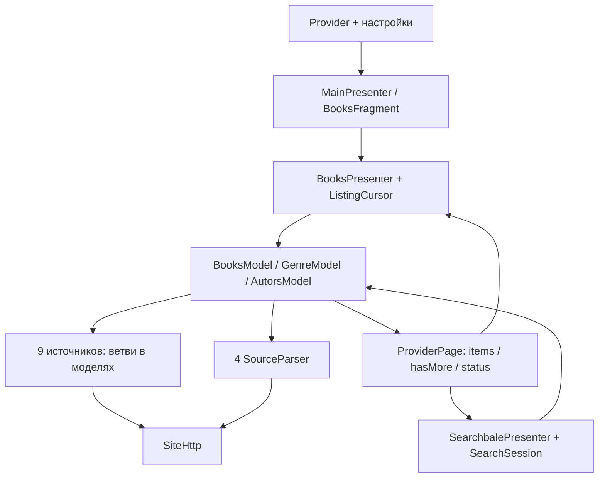

# Подготовка AudioBooks к расширению источников: анализ и план

Дата: **29 октября 2026 года**. База анализа: рабочее дерево на коммите `96523bd`, версия приложения `7.8`, Room schema `18`.

**Результат работы — этот документ и [список задач](todo.md), а не выполненный рефакторинг.** Анализ основан на чтении реализации, ресурсов и существующих тестов. Исходные требования: [исследование новых источников](../docs/new-audiobook-sources.ru.md) и [руководство разработчика](../docs/howto.md). Работоспособность всех сайтов, Android-плеера и производительность в этом анализе заново не измерялись; сведения о кандидатах ниже относятся к проверкам, описанным в исходном исследовании.

## 1. Рекомендация

Приложение уже имеет полезную основу: реестр `Provider`, четыре адаптера `SourceParser`, отдельные курсоры источников в поиске, классификацию ошибок, Media3 для MP3/HLS, идентичность загрузок и тесты парсеров на сохранённых страницах. Переписывать приложение, переводить его на Kotlin/Compose или создавать загружаемую систему плагинов для этой задачи не требуется.

Основное препятствие — **незавершённый переход от распределённой по моделям логики сайтов к полноценным адаптерам**. Девять источников работают через ветви общих классов, четыре — через `SourceParser`. Даже новый адаптер зависит от HTML `Document`, Android ID меню и общих переключателей периодов. Простая HTML/MP3-площадка добавляется сравнительно легко; JSON API, неодинаковые фильтры и общий MP3 с главами выявляют пробелы контракта.

Рекомендуемый путь:

1. Зафиксировать поведение 13 источников и совместимость сохранённых данных.
2. Ввести небольшой интерфейс операций источника, за которым HTML и JSON остаются внутренними деталями. Сохранить существующие парсеры и тесты через временный переходный адаптер.
3. Сделать возможности меню зависимыми от текущего раздела; хранить сортировку, период и фильтры как данные, а не извлекать их из подписи экрана.
4. Ограничить сетевую конкуренцию, добавить отмену реального запроса и общий бюджет операции. Развести жизненный цикл метаданных и временных медиассылок.
5. Проверить интерфейс на разных вертикальных сценариях: Aknigi24 — HTML/MP3, Lis10book — JSON, Audiokniga-online.ru — DLE POST, Audiokniga.one — HLS. Затем подключать остальные выбранные источники по тому же договору.
6. Перенести девять старых источников по одному; отдельно реализовать общую медиасущность для нескольких глав одного MP3 перед Golosknig.

Готовность архитектуры проверяется практическим результатом: очередной источник уже известного типа добавляется через адаптер, строку реестра, ресурсы/manifest и тестовые данные, **без новых ветвей по доменам в presenters, поиске, плеере и загрузчике**. Новый транспорт или формат может потребовать общего изменения; это отдельная явно проверяемая возможность, а не скрытый побочный эффект подключения сайта.

## 2. Как устроена интеграция сейчас

### 2.1. Реестр, навигация и состояние пользователя

Авторитетный список — [Provider.java](../app/src/main/java/com/fanok/audiobooks/search/Provider.java). Он содержит `server`, название, `prefValue`, `prefKey`, постоянный `sourceId`, адреса главной/жанров/авторов/чтецов и nullable `parser`.

- [MainPresenter](../app/src/main/java/com/fanok/audiobooks/presenter/MainPresenter.java) открывает разделы выбранного источника. `null` в адресе индекса людей означает отсутствие раздела, но не запрещает ссылки автора/чтеца в книге.
- [SettingsFragment](../app/src/main/java/com/fanok/audiobooks/fragment/SettingsFragment.java) строит список источников и флажки поиска из `Provider.values()`; [BooksFragment](../app/src/main/java/com/fanok/audiobooks/fragment/BooksFragment.java) так же строит подменю переключения сайтов.
- [Consts.setSOURCE](../app/src/main/java/com/fanok/audiobooks/Consts.java) сопоставляет сохранённое значение `sorce_books` с `prefValue`. Порядок enum не равен `sourceId`: Akniga стоит первой, но имеет ID 3. Нельзя мигрировать ID через `ordinal()` или перенумеровать старые значения.
- [Url.canonical](../app/src/main/java/com/fanok/audiobooks/Url.java) обслуживает известные алиасы доменов. [LoadBook](../app/src/main/java/com/fanok/audiobooks/activity/LoadBook.java) проверяет источник внешней ссылки и открывает книгу; входящие домены отдельно перечислены в [AndroidManifest.xml](../app/src/main/AndroidManifest.xml).
- `BookPOJO.requireSupported` повторяет проверку домена по реестру. Реестр сейчас распознаёт сайт по одному основному хосту после canonical; домены API, обложек и CDN не должны автоматически становиться допустимыми внешними ссылками книги.

### 2.2. Матрица всех 13 источников

Это возможности **реализации**, не новая проверка доступности сайтов. Во всех строках предусмотрены каталог, поиск книг, жанры, карточка и аудио. «Индексы людей» и «поиск людей» различаются. Обложки извлекаются парсерами; отсутствие картинки у конкретной книги должно оставаться допустимым.

| Источник / ID | Навигация и поиск | Выборки и время карточки | Аудио и особенности интеграции |
|---|---|---|---|
| Akniga / 3 | Индексы авторов/исполнителей, поиск книг и людей, серии, подборки | Новые, популярные, обсуждаемые; 1/7/30/365/всё; длительность книг, но не карточек подборок | AJAX/token, HLS и границы глав; комментарии, другие озвучки; legacy-ветви |
| Книга в ухе / 0 | Жанры, индексы и поиск авторов/чтецов, серии | Новые, популярные, рейтинг; день/неделя/месяц/всё; время в карточке | `BookPlayer` JSON; комментарии и другие озвучки; legacy |
| ИзиБук / 1 | Жанры, индексы и поиск людей, серии | Новые, популярные за всё время; каталог через PDA с длительностью | `XSPlayer`, префикс MP3 и подпись; чтение комментариев не реализовано; legacy |
| AudioBook-mp3 / 2 | Индексы авторов/исполнителей, поиск книг и авторов; отдельного поиска чтецов нет | Новые, Top-100, случайная книга; каталог с временем, поиск беднее | Playerjs → внешний JSON; поиск режет общую выдачу на порции по 40; `SeriesModel` возвращает пусто; legacy |
| База Книг / 4 | Жанры, ссылки автора/чтеца/серии из книги; поиск книг | Просмотры, рейтинг, комментарии, год; серверные дата/время в `/f/`; жанру нужен category ID | Специальный плеер/iframe, контекст озвучки `sorce`; cookie-сессия, комментарии; legacy |
| Книгоблуд / 5 | Жанры, ссылки автора/чтеца/серии; поиск книг | Новые, сегодня, неделя/месяц, тренды, дослушивают; время есть; жанр рейтинга локально | `KB.playerInit`; жанры в коде перечислены UUID; комментарии пустые; legacy |
| Audioboo / 6 | Жанры, индексы авторов/чтецов, серии; поиск книг | POST: дата, название, рейтинг, просмотры, комментарии, длительность; без периодов | Inline Playerjs; специальный POST/redirect в `SiteHttp`; комментарии; legacy |
| Отрубин / 7 | Жанры, ссылки людей/серии; поиск книг | Новые, популярные неделя/месяц; **времени в карточках нет**; жанр рейтинга локально | `XSPlayer` либо inline Playerjs; комментарии пустые; legacy |
| Полекниг / 8 | Жанры, ссылки людей/серии; поиск книг | Новинки/популярные, в том числе в жанре; время есть | Playerjs → внешний JSON; комментарии пустые; legacy |
| уКниг / 9 | Жанры, индексы людей и серии; поиск только книг | Новые, популярные по периодам, лучшие; жанровые рейтинги; часть глобальных выборок конечная | `createPlayer` → JSON → MP3; фрагмент исключается; `Uknig`, комментарии по умолчанию пустые |
| Аудиокниги.fun / 10 | Индексы жанров/людей, циклы/подборки; поиск только книг | DLE POST: дата, рейтинг, просмотры, комментарии, название; без периодов; время есть | XHR JSON с Referer, signed MP3; серии/рекомендации/комментарии в адаптере |
| Aknig.xyz / 11 | Жанры, ссылки людей/цикла; поиск книг | DLE POST и category ID; дата/рейтинг/просмотры/комментарии/название; время есть | Playerjs → JSON → MP3; удаление книги; серии/рекомендации/комментарии в адаптере |
| Аудиокнига Life / 12 | Жанры/поджанры, ссылки людей/цикла; поиск книг | `/f/`: дата/рейтинг/просмотры/комментарии/название; ID жанра; время есть | Inline `playerInit` → MP3 с длительностями; серии/комментарии в адаптере |

Проверяемые точки матрицы: [SearchUrls](../app/src/main/java/com/fanok/audiobooks/search/SearchUrls.java), [BooksModel](../app/src/main/java/com/fanok/audiobooks/model/BooksModel.java), [GenreModel](../app/src/main/java/com/fanok/audiobooks/model/GenreModel.java), [AutorsModel](../app/src/main/java/com/fanok/audiobooks/model/AutorsModel.java), [BooksPresenter](../app/src/main/java/com/fanok/audiobooks/presenter/BooksPresenter.java), [AudioModel](../app/src/main/java/com/fanok/audiobooks/model/AudioModel.java), [SeriesModel](../app/src/main/java/com/fanok/audiobooks/model/SeriesModel.java), [ComentsModel](../app/src/main/java/com/fanok/audiobooks/model/ComentsModel.java), [OtherArtistModel](../app/src/main/java/com/fanok/audiobooks/model/OtherArtistModel.java), [адаптеры](../app/src/main/java/com/fanok/audiobooks/source).

### 2.3. Каталог, поиск, сортировки и пагинация



**Каталог.** `BooksPresenter.pageUrl` выбирает адаптер или старую схему URL; `BooksModel` загружает и разбирает страницу. [ListingCursor](../app/src/main/java/com/fanok/audiobooks/search/ListingCursor.java) хранит номер, элементы и ключи дедупликации. Refresh заменяет список только после успешного ответа: проверка `isFailure()` находится в `BooksPresenter.onPage`, сам `ListingCursor.apply` её не выполняет. Повтор страницы без новых элементов завершает курсор. Это полезная защита, но её нельзя безусловно переносить на cursor API, где перекрывающиеся страницы могут быть допустимы.

**Основной поиск книг.** [SearchbalePresenter](../app/src/main/java/com/fanok/audiobooks/presenter/SearchbalePresenter.java) выбирает включённые источники и создаёт [SearchSession](../app/src/main/java/com/fanok/audiobooks/search/SearchSession.java). У каждого источника свой номер страницы, статус и retry той же страницы. Результаты показываются по мере прихода, дедуплицируются по canonical URL. Смена поколения защищает от запоздавшего ответа предыдущего запроса. Таймаут — 10 секунд на источник. Один дополнительный проход с другим регистром выполняется только для `EMPTY`.

Важная поправка к разделу 1.2 исходного исследования: [SearchebleModel](../app/src/main/java/com/fanok/audiobooks/model/SearchebleModel.java) обслуживает **chips авторов/серий**, сейчас для Knigavuhe и ABMP3; это не исполнитель основного поиска по всем сайтам. Поиск авторов и чтецов — отдельные категории `SearchUrls`, запускаемые для текущего источника.

**«На других сайтах».** [OtherSourceModel.getOtherArtist/searchAll](../app/src/main/java/com/fanok/audiobooks/model/OtherSourceModel.java) обходит остальные `Provider`, не получает флажки поиска из настроек, использует параллельные запросы и `Single.zip`. Ошибки превращаются в пустые списки, публикация ждёт весь набор. Здесь нет тех же гарантий видимости частичных ошибок и постепенной выдачи, что у `SearchSession`. Нельзя считать два режима уже унифицированными.

**Сортировки.** Для новых адаптеров используются `optionsMenu/sortUrl/hasSort`; для старых — XML и ветви `BooksPresenter`/`BooksFragment`. В Audioboo `BooksModel.audiobooListing` выбирает POST sort по вхождению локализованной строки в `nameModel`. Это прямой пример зависимости запроса от текста интерфейса.

**Фильтры.** [ListingFilters](../app/src/main/java/com/fanok/audiobooks/search/ListingFilters.java) умеет интервал длительности `[from,to)` в минутах, периоды и сохранение жанра. Часть операций делегируется адаптеру, но `periods/periodOf/withPeriod`, серверный фильтр времени и локальный `cardGenre` остаются привязаны к конкретным источникам. Период рейтинга и ограничение даты публикации Базы Книг имеют разный смысл, хотя используют один `Period`.

Локальная длительность фильтрует только прочитанные карточки. Неизвестное время допускается при `ANY`, но исключается при заданном диапазоне. Автоматический обход ограничен четырьмя страницами за действие; остановка также зависит от 6 новых совпадений и заполнения списка до 21 элемента. Пользователь может продолжить поиск. [GenreSort](../app/src/main/java/com/fanok/audiobooks/search/GenreSort.java) отдельно сортирует **загруженный список жанров** по имени/количеству, а не все книги сервера.

### 2.4. Карточка, обложка, описание и связанные данные

[BookPOJO](../app/src/main/java/com/fanok/audiobooks/pojo/BookPOJO.java) содержит текстовое время, `reting`, автора, чтеца, один жанр и одну серию со ссылками. В нём же находится часть загрузки/парсинга книг старых источников. Например, Knigavuhe записывает просмотры в `reting`. [GenreSort.count](../app/src/main/java/com/fanok/audiobooks/search/GenreSort.java) использует `GenrePOJO.reting` как количество книг. Названия полей не задают достоверную семантику.

[BookDescriptionModel](../app/src/main/java/com/fanok/audiobooks/model/BookDescriptionModel.java) уже разделяет сохранённый URL книги и текущий URL страницы; описание и рекомендации делят один `Single<Document>.cache()` внутри модели, ошибка сбрасывает кэш. Но отдельные `AudioModel`, `SeriesModel`, `ComentsModel` могут вновь читать ту же страницу. Общего контекста открытия книги между ними нет.

Обложки требуют отдельной проверки: [BooksListAddapter](../app/src/main/java/com/fanok/audiobooks/adapter/BooksListAddapter.java) использует Glide; ряд других экранов использует Picasso. [App](../app/src/main/java/com/fanok/audiobooks/App.java) настраивает общий OkHttp/Picasso и Referer для известных хостов. В просмотренном `app/src/main` нет регистрации `GlideModule`/`OkHttpUrlLoader`, а в зависимостях нет Glide OkHttp integration. Поэтому утверждение «все обложки получают настройки общего OkHttp» кодом не подтверждается. Это риск для новых CDN с Referer, не доказанный сбой каждой существующей картинки.

### 2.5. Аудио, загрузка, офлайн и хранение

1. `AudioModel.getAudio` получает страницу и плейлист, возвращает `AudioPOJO`: URL, имя, длительность в секундах и опциональные `timeStart/timeFinish`. Отдельного MIME, стабильного ID главы и ID общего media resource в модели нет.
2. [MediaPlayerService](../app/src/main/java/com/fanok/audiobooks/service/MediaPlayerService.java) строит MediaItem и применяет clipping. [PlaybackErrorPolicy](../app/src/main/java/com/fanok/audiobooks/service/PlaybackErrorPolicy.java) уже отличает временные ошибки и 401/403/410, для которых предусмотрено обновление списка глав. `refreshChapters` проверяет **число** глав, после чего продолжает по индексу. Совпадение размера не доказывает идентичность глав при перестановке.
3. [DownloadUtil](../app/src/main/java/com/fanok/audiobooks/util/DownloadUtil.java) создаёт контекст заголовков для конкретной книги, download/playback data sources и Media3 downloads. `mediaHeaders(bookUrl)` у адаптера уже есть. Cookies специально передаются для Базы Книг; общего переносимого контекста авторизации страницы/API/CDN ещё нет.
4. [DownloadIds](../app/src/main/java/com/fanok/audiobooks/download/DownloadIds.java) задаёт MP3 ID `v1/<book>/chapter/<ordinal>` и отдельный custom cache key на главу. HLS-главы объединяются по `stream/<host/path>` без custom cache key. Query у HLS stream key удаляется; поэтому разные реальные ресурсы, различающиеся значимым query, нуждаются в явной идентичности, а не новом глобальном правиле удаления параметров.
5. [AudioListDBModel.syncChapters](../app/src/main/java/com/fanok/audiobooks/model/AudioListDBModel.java) сопоставляет URL, затем legacy download ID с проверкой имени, затем позицию с проверкой имени; сохраняет экспортированные копии. Это уже защита пользовательских файлов. Но имя/позиция не заменяют стабильный chapter ID; переименование и перестановки требуют отдельного договора.
6. [ChapterExtractor](../app/src/main/java/com/fanok/audiobooks/util/ChapterExtractor.java) экспортирует главы из кэша, включая поддержанные HLS-сегменты; явно отклоняет HLS с initialization segments/fMP4. Воспроизводимость HLS и возможность экспорта — разные способности.
7. [Room](../app/src/main/java/com/fanok/audiobooks/room/AppDatabase.java) сейчас версии 18; история/избранное/сохранённые книги связаны с URL. Есть миграции 15→16→17→18, сохранённые схемы 17/18 и разрешённые destructive fallback для старых версий/понижения. Новая миграция не должна расширять область потери данных.

### 2.6. Сеть и защита страниц

[SiteHttp](../app/src/main/java/com/fanok/audiobooks/net/SiteHttp.java) использует Jsoup, cookie map по хосту, 10-секундный timeout (30 секунд для Audioboo), ограничение тела 4 MiB, проверку известных challenge и HTTP-ошибок. Слишком большой ответ отклоняется; ошибку нельзя превращать в конец каталога. Есть специальный POST с контролируемыми redirect для Audioboo. JSON-плейлисты местами уже читаются как raw body, но проверяются через HTML parse.

Уточнение к общему описанию cookies в `howto.md`: [ActivityCookies](../app/src/main/java/com/fanok/audiobooks/activity/ActivityCookies.java) жёстко привязана к `Url.SERVER_BAZA_KNIG` и `PHPSESSID`. Это не универсальная процедура прохождения challenge любого нового источника. Универсальный WebView не нужен для первого этапа; сначала следует использовать подтверждённые прямые HTTP/API-маршруты кандидатов.

## 3. Критические проблемы и приоритеты

Приоритет означает порядок архитектурной работы, не утверждение о воспроизводящемся пользовательском баге. «Риск» ниже выведен из кода; его масштаб надо измерить.

| Приоритет | Подтверждённая точка | Последствие расширения | Что изменить |
|---|---|---|---|
| P0 | `Provider.parser == null`, ветви в моделях, `BookPOJO`, presenters | Для одного сайта приходится согласовывать несколько мест | Один интерфейс операций источника; миграция по одному сайту с удалением его старых ветвей |
| P0 | `SourceParser.fetch/listing/...` требуют `Document` | JSON API приходится маскировать под HTML или обходить общие модели | Вызывать операцию адаптера, получать предметный результат; парсер HTML оставить внутренним |
| P0 | `sortUrl(int R.id, String)`, строковый `nameModel`, switch периодов | Скрытая потеря жанра/периода, ошибочные пункты меню | `ListingQuery` и `ListingOptions` по контексту; стабильные ключи сортировок |
| P0 | `Observable.merge(calls)` без предела в `SearchSession`, `zip` в `OtherSourceModel` | Рост сетевого fan-out при 20+ источниках; ожидание медленных сайтов | Общая очередь metadata-запросов, отмена, частичные статусы и результат по мере прихода |
| P0 | `Single.fromCallable`/`Observable.create` вокруг синхронных загрузок без явного cancel handle | Dispose прекращает доставку, но не доказывает остановку сетевой работы | Связать отмену с транспортом; отдельно мерить реально активные запросы |
| P0 | MP3 download ID по ordinal, HLS по host/path; refresh по числу глав | Неверное продолжение после перестановки; дубли общего MP3 | Стабильные book/chapter/resource IDs и безопасное сопоставление; отдельный этап миграции |
| P1 | `ProviderPage.EMPTY` может получиться при отсутствии селекторов; широкие catch в парсерах | Изменение сайта выглядит как отсутствие книг | Валидация формы ответа, явный empty marker, счётчики parsed/skipped/raw |
| P1 | `SourceParser` default `hasSort/listsDuration=true`, optional методы пустые | Интерфейс обещает возможности, которые адаптер не проверил | Явные возможности и результат `unsupported`, отличный от «поддержано, но пусто» |
| P1 | `BookPOJO.time/reting`, один genre | Ложные фильтры времени, смешение рейтинга/просмотров, потери нескольких жанров | Нормализованные optional значения и семантика метрик, адаптация старых полей |
| P1 | Разные загрузчики обложек; статический Referer по хосту | Часть экранов не получает нужный контекст CDN | Единый контракт `CoverRef`/запроса, проверки обоих путей отображения |
| P1 | Отдельные fetch страницы для description/audio/series/comments | Лишние запросы при открытии книги | Контекст открытия с объединением одинаковых in-flight запросов; ленивая загрузка вкладок |
| P1 | DLE параметры и page size зашиты в helper; `Dle` вызывает `BooksModel.postForm` | Чужая площадка тихо игнорирует сортировку/страницу | Небольшие настраиваемые помощники форм/пагинации в модуле источников/сети |
| P2 | Static category caches, списки UUID, копирование merged результатов; Room разрешает main-thread queries | Риск памяти/задержек на больших списках | Измерение, ограниченный кэш, точечная оптимизация горячих участков |

Не следует заранее оптимизировать линейный `Provider.ofUrl` для 13–25 строк: сетевые запросы и повторная обработка карточек значительно более вероятные места затрат. Это гипотеза приоритета, а не результат профилирования.

## 4. Предлагаемый контракт источника

### 4.1. Операции вместо обязательного HTML

Предлагаемое название — `BookSource`. Это новый небольшой Java-интерфейс проекта; одноимённые классы из `book-sources/sources` относятся к другой архитектуре и не должны переноситься целиком.

| Операция интерфейса | Вход | Результат и правило |
|---|---|---|
| `options` | Контекст раздела | Разрешённые сортировки/периоды/фильтры; без сетевого запроса при открытии каждого меню |
| `loadListing` | `ListingQuery`, continuation, контекст запроса | `Page<BookSummary>`; запрос и parsing скрыты в адаптере |
| `search` | Категория, исходная строка, continuation, контекст | Страница книг/людей согласно объявленным возможностям |
| `loadIndex` | Жанры/авторы/чтецы и continuation | Страница ссылок на сущности; индекс людей отделён от поиска людей |
| `loadBook` | `BookRef`, контекст открытия | Метаданные, доступность, рекомендации со страницы и ссылки на связанные данные; без обязательного получения аудио |
| `resolvePlayback` | `BookRef`, выбранная озвучка, причина обновления | `PlaybackPlan`: главы, ресурсы, запросы медиа, optional expiry |
| Опциональные `loadSeries/loadComments/findNarrations` | Ссылка/книга и continuation | Страница/результат с различием unsupported, empty и failure |

Не вводить универсальный `execute(Object)` и десятки интерфейсов по одному методу. Достаточно реестра, одного адаптера на сайт, общей оркестрации запросов и уже существующих playback/download модулей. Типизированные результаты должны скрывать различия сайтов от callers, а не переносить их в очередной огромный dispatcher.

**Почему не JSON внутри `Document`.** Такой вариант упомянут в исходном исследовании как практический обход. Для запланированной подготовки архитектуры лучше прямой JSON-парсер: нет лишнего DOM, скрытой схемы контейнера и необходимости угадывать, какая «страница» передана в `description`. Временный `HtmlSourceAdapter` может использовать текущий `SourceParser.fetch + parse`, не меняя все четыре реализации сразу. После миграции HTML-helper остаётся только там, где упрощает реальный код; вечный слой переадресации ради совместимости не нужен.

На этапе перехода `Provider` получает метод, возвращающий **ненулевой** `BookSource`: новый адаптер, HTML bridge либо временный legacy bridge. Caller не должен проверять `parser != null`. Bridge старых сайтов должен вызывать выделенные реализации и не уходить обратно в новый dispatcher — иначе получится рекурсия. Переносить можно по операции, но итоговый критерий завершения миграции сайта — отсутствие его бизнес-логики в общих моделях.

Переход обязательно охватывает все входы: `BooksModel`, `GenreModel`, `AutorsModel`, `BookDescriptionModel`, `AudioModel`, `SeriesModel`, `ComentsModel`, `OtherArtistModel`, `OtherSourceModel` и deep-link загрузку из `BookPOJO.getDescription`. Одной замены `Provider.parser` недостаточно. Загрузку/парсинг из `BookPOJO` переносить в источник, оставляя POJO переносчиком данных; совместимые статические методы временно делегируют новому пути. Дополнительный запрос рекомендаций допустим как optional операция, если источник не возвращает их вместе с detail.

### 4.2. Что должно быть данными

| Тип | Минимальные поля / инвариант |
|---|---|
| `SourceDescriptor` | Постоянные ID и preference keys; display name; подтверждённые book-host aliases; входные разделы. `Provider` может остаться enum-хранилищем этих данных |
| `BookRef` | `sourceId`, стабильный локальный ID сайта при наличии, canonical web URL, optional narration ID. Сохранённый legacy URL остаётся отдельным ключом совместимости |
| `ListingQuery` | Раздел и entity reference, строка поиска при применимости, sort key, направление, период с семантикой, длительность. Без Android `R.id` и локализованной подписи |
| `Continuation` | Для первых сайтов номер страницы; интерфейс допускает opaque token/next link/offset. Не генерировать token API арифметикой номера |
| `Page<T>` | Items, next continuation, статус, безопасная диагностика. Пустая после фильтрации страница с next допустима; конец только по подтверждённой семантике ответа |
| `ListingOptions` | Варианты сортировки и их смысл; разрешённые периоды именно для этого sort и раздела; режим фильтра `SERVER`, `LOCAL`, `UNSUPPORTED` |
| `BookSummary` | Название, reference, `CoverRef`, optional durationSeconds с происхождением, ссылки людей/жанров/серий, раздельные метрики |
| `PlaybackPlan` | Упорядоченные главы с постоянными ключами, ресурсы с ключами, фактический MIME/тип, headers/cookie policy, clip interval, optional expiry |

Это проект интерфейса, не обязательство немедленно создать класс на каждую ячейку. На первом срезе допустимы компактные вложенные value types. Не создавать DI framework, event bus, generic plugin loader и новую базу каталога.

### 4.3. Семантика сортировок и фильтров

Ключи `new`, `views`, `rating`, `comments`, `title`, `duration`, `trending`, `finished` должны различаться. Набор расширяется адаптером с подписью/description; это не новый глобальный `switch(source)` в UI. Отдельно обозначать фиксированные подборки TOP100/TOP30 и случайную книгу: они не эквивалентны сортировке полного каталога.

Для каждой комбинации раздела и sort хранить:

- область: весь каталог, жанр, автор, чтец, серия, поиск;
- серверный порядок и допустимое направление;
- смысл времени: окно популярности либо дата публикации; набор допустимых периодов;
- поддерживаемость длительности и полноту метаданных карточек;
- способ сохранения контекста: server query либо честная локальная фильтрация.

Например, Библус может объявить неделю/месяц для популярности, но не год. Slushat-knigi — две конечные TOP-подборки. Audiokniga.one требует выяснить смысл `popular.html`; имя endpoint не равно семантике. Порядок серии по номеру части не следует заменять сортировкой по новизне.

Переход «жанр → рейтинг → следующая страница → другой период → Назад» обязан сохранять entity reference. Если сочетание не поддержано, UI скрывает вариант или явно предлагает смену области. Нельзя молча отбросить жанр через default `inGenre`.

DLE POST должен содержать все нужные поля **на каждой странице**, включая явный возврат к дате после рейтинга. Настраиваются имена полей, category/session keys, направление и page size. В текущем `Dle.sortedListing` используется `set_direction_sort=desc`; у Audiokniga-online.ru исходное исследование фиксирует ключ `dle_direction_main`. Копирование helper без проверки серверного протокола неверно. Если сайт хранит sort в общей сессии, параллельные операции одного сайта нужно сериализовать или изолировать подтверждённым способом; explicit POST сам по себе не доказывает отсутствие гонки серверной сессии.

Для Playerjs уже доступен публичный `AudioModel.loadPlayerjs`, а вложенные `folder` рекурсивно обрабатывает `addPlayerjsItems`. Первый адаптер может переиспользовать этот путь. Вынос в небольшой helper оправдан для устранения зависимости адаптера от model и передачи нового request context; повторно писать рекурсивный parser с нуля не нужно.

### 4.4. Метаданные и категории

Вводить числовую длительность в секундах с состоянием «неизвестно» и происхождением `LISTING`, `DETAIL`, `PLAYLIST`. Не записывать неизвестность как нулевую полноценную книгу. Сохранить исходный текст для диагностики/совместимости; форматирование выполняется в UI. Точность данных Lis10book ещё требует проверки: просто числовое поле API не гарантирует правильную длительность.

Локальный фильтр должен сообщать число просмотренных/показанных карточек и наличие неизвестной длительности. Не скачивать описания всех результатов ради времени или обложки. Дополнительные сведения получать при открытии книги, либо ограниченно для видимых элементов, если это действительно необходимо и измерено.

Разделить `rating(value, scale, origin)`, `views`, `commentCount`; неизвестные значения скрывать. Рейтинг 9.8/10 не превращать в 9.8/5; нельзя глобально сортировать смешанные результаты разных сайтов по несопоставимому `reting`. Старое поле оставить на переходе, не угадывать его смысл без знания источника.

Списки авторов/чтецов/жанров должны сохранять собственные IDs/URL; отображение может выбирать основной элемент для совместимости. Для [ParentalControl](../app/src/main/java/com/fanok/audiobooks/policy/ParentalControl.java) нужен отдельный тест соответствия жанра карточки индексу разрешённых категорий. Сейчас неизвестная категория блокируется при включённом контроле. Несколько жанров нельзя трактовать как автоматическое разрешение по любому удобному тегу: сначала сохранить существующее решение по основному genre, затем отдельным изменением определить политику множественных категорий.

Обложка: извлекать настоящий `data-src/srcset/src` по правилам адаптера, разрешать относительные адреса по конечному URL ответа, сохранять значимый query подписанного URL. `CoverRef` может нести scoped headers; передать их в существующий Glide через запрос изображения. Проверить также Picasso-экраны. Не переводить весь UI на другую библиотеку только ради первого нового сайта.

## 5. Сеть, ошибки и скорость

### 5.1. Транспорт и жизненный цикл

Сначала вынести `postForm` из `BooksModel` в сетевой/helper модуль: направление зависимости `source.Dle → model.BooksModel` не требуется. Ввести запрос с method, URL, form/body, допустимым форматом и политикой контекста. Обработчик ответа возвращает status, final URL, headers и ограниченное тело; HTML разбирается Jsoup, JSON — уже имеющимся Gson. JSON с `text/html` допускается в известном playlist endpoint после валидации содержимого, а не глобального игнорирования Content-Type.

Существующие Jsoup-пути можно сохранить в переходном adapter transport. Для нового отменяемого транспорта использовать уже имеющийся OkHttp; перед переходом всех сайтов подтвердить cookies, charset, редиректы, POST Audioboo, TLS, proxy и limits. Не обещать эквивалентность двух клиентов только потому, что оба делают GET.

Cancellation context принадлежит одной пользовательской операции и передаётся через все дополнительные fetch. При dispose прекращать сетевой вызов, освобождать слот очереди и body. UI generation guard сохранить независимо от отмены. Таймаут ответа одного fetch и deadline всей операции различаются: книга со страницей, token и playlist не должна бесконечно складывать отдельные timeout.

Предлагаемый стартовый предел metadata/search — **4 активные операции глобально, не более 2 на источник**, с отдельным ограничением общего CDN при необходимости. Значения — параметры эксперимента, а не измеренный оптимум. Таймаут исполнения источника начинать после получения слота; очередь учитывать отдельным общим deadline, чтобы последние сайты не получили ложный timeout ещё до старта. Воспроизведение и возобновление медиа не должны стоять в очереди поиска. Для DLE с сессионным sort может понадобиться 1 операция на сайт.

### 5.2. Ошибки, которые нельзя смешивать

Сохранить успешную пустую выдачу и конец списка отдельно от сетевой ошибки. Расширить диагностический reason, не заставляя все UI сразу обрабатывать новый enum: `NETWORK`, `TIMEOUT`, `RATE_LIMITED`, `CHALLENGE`, `PARSE_CHANGED`, `REMOVED`, `PREVIEW_ONLY`, `AUTH_REQUIRED`, `UNSUPPORTED`.

- 429 — ограничение частоты: учитывать `Retry-After`, ограничивать retry; не предлагать автоматически cookie-экран.
- 503 может быть временной ошибкой либо challenge; текущий `ProviderPage.failed` относит его к `BLOCKED` без анализа. Улучшать классификацию с сохранением исходного HTTP status.
- HTTP 200 с неизвестным challenge/сломавшейся разметкой не равен `EMPTY`. Для каждого парсера нужны признаки ожидаемой страницы и реального отсутствия результатов.
- Отдельная плохая карточка может быть пропущена, но «все карточки не разобрались» требует диагностики; счётчики raw/parsed/skipped отличают сломанную схему от сознательной фильтрации недоступных книг.
- Removed/preview/auth не должны автоматически превращаться в общий parse error или запускать бесконечное обновление плейлиста.
- `OtherSourceModel` должен сохранять частичный результат и показывать, что часть сайтов недоступна; пустой список после ошибки не доказывает отсутствие других озвучек.

Cookies и авторизационные заголовки привязывать к host/path/secure/domain policy. Заголовок `Cookie` нельзя раздавать всем дочерним HLS/CDN запросам. Каталог, API, cover и media имеют разные требования; адаптер задаёт допустимый контекст, транспорт обеспечивает его применение и проверку redirect. Общий proxy сохраняется, TLS-проверка не отключается.

### 5.3. Кэширование и повторные запросы

Начать с контекста одного открытия книги: объединять одинаковые in-flight fetch для описания, серии, комментариев и аудио, если ответ действительно общий. Опциональные вкладки загружать при обращении. Существующее объединение description/recommendations в `BookDescriptionModel` сохранить.

Метаданные можно ограниченно кэшировать по `(source, operation, query, continuation, sort, period, locale/session version)`; для POST учитывать body. Ввести ограничение количества/байтов и TTL, очистку при смене сессии/источника по необходимости. Не кэшировать ошибку или challenge как пустую страницу. Не делать бессрочный общий `Map<String, Document>`: DOM может быть большим, mutable и содержать персональный контекст.

Подписанные URI живут отдельно от стабильных метаданных. Истечение `expires` либо AUTH-ошибка приводит к повторному `resolvePlayback`, ограниченному общим retry budget. Кэш метаданных не должен мешать получению нового плейлиста. HLS manifest может содержать истекающие key/segment URL: обновление верхнего MP3-like URI проблему не решает автоматически.

### 5.4. Проверяемые ограничения производительности

Не заявлять ускорение без сравнения. До изменений собрать baseline на фиксированных fixtures и локальном сервере, затем повторить на одном устройстве и одинаковой сборке. Сетевые замеры живых сайтов хранить отдельно.

| Метрика | Предлагаемое условие приёмки |
|---|---|
| Запросы каталога/поиска | Нет нового N+1 detail на карточку; дополнительные запросы объяснены протоколом и посчитаны |
| Конкуренция | Даже при 25 fake sources соблюдён установленный предел; медиа не ждёт search queue |
| Отмена | Закрытый поиск не занимает сетевые слоты после отмены; проверить счётчиком сервера, не только отсутствием UI callback |
| Первый результат | Быстрый источник публикуется до окончания медленного; источники в очереди не считаются заранее упавшими |
| Фильтр длительности | По умолчанию сохраняется предел 4 страниц за действие; отдельная кнопка продолжения, без обхода всего каталога |
| Старые 13 источников | Предлагаемый порог: медиана/p95 ключевых сценариев не хуже baseline более чем на 10% после оценки шума повторных прогонов; иначе анализ trace, а не автоматическое расширение порога |
| UI/память | Не добавлять работу сети/DOM на main thread; 20 циклов поиска/открытия/закрытия не оставляют растущего набора запросов/моделей; retained heap и frames сравнить с baseline |
| Общий MP3 | Несколько глав с одним resource дают один download и один набор cache bytes; число экспортов соответствует выбранным главам |

Порог 10%, concurrency 4/2 и TTL ещё требуют калибровки на устройстве: сейчас это предложенные критерии, не достигнутые показатели. Команды `dumpsys gfxinfo`, `meminfo`, Perfetto и проверка release-сборки описаны в [howto.md](../docs/howto.md). При большой смешанной выдаче отдельно измерить копирование `SearchSession.items()` и повторный render, а также DB-чтения в binding карточки; менять их по профилю.

## 6. Модель аудио и сохранность данных

### 6.1. Разделить главу, файл и URL запроса

Предлагаемый `PlaybackPlan` должен выражать три случая:

| Случай | Главы | Ресурсы загрузки |
|---|---|---|
| Отдельный MP3 на главу | N chapter IDs | N resource IDs |
| Один MP3 и временные главы | N chapter IDs + clip intervals | 1 resource ID, один download/cache key |
| HLS: общий поток или поток на главу | Главы с optional clips | По одному resource ID на реальный поток; manifest/segments/keys принадлежат ему |

Текущая поддержка HLS не требует замены плеера. Media3 позволяет указывать MIME для адреса без стандартного расширения и clipping через `MediaItem`; это подтверждается [официальной документацией Media items](https://developer.android.com/media/media3/exoplayer/media-items). В проекте MIME сейчас в основном выводится из `.m3u8`; новый контракт должен сохранять его явно через adapter → DB/download request → playback.

Скачивание, кэш и жизненный цикл фоновых загрузок следует оставить за существующими Media3 `DownloadService/DownloadManager`, чьи роли описаны в [официальной документации](https://developer.android.com/media/media3/exoplayer/downloading-media). Экспорт отдельных глав остаётся ответственностью приложения и проверяется отдельно.

Не объединять файлы только по URL без query: `get.php?file=1` и `?file=2` могут быть разными главами. Адаптер обязан различать идентифицирующие параметры и временные подписи. Предпочтение — ID главы/ресурса из данных сайта; если их нет, документированный стабильный ключ с проверкой сопоставления. Перемена CDN не должна сама менять личность ресурса, но одинаковый путь на разных хостах также не доказывает идентичность.

### 6.2. Refresh и скачивание

Уже имеющийся `refreshChapters` доработать до сопоставления главы по ключу. При одинаковом числе, но другом порядке нельзя продолжать по прежнему индексу. Если сопоставление неоднозначно, сохранить checkpoint и показать ошибку/потребность выбора главы. Не наследовать локальный файл другой главы по совпадению позиции.

Обновление должно обслуживать и playback, и downloads: наличие refresh в плеере не доказывает refresh очереди загрузок. Нужен единый resolver с объединением одновременных обновлений одной книги и ограниченным повтором. Продолжение частичного файла допустимо только при подтверждённой идентичности ресурса; изменения содержимого/ETag/размера нельзя маскировать стабильным cache key.

Для Golosknig выбор одной clip-главы может потребовать загрузить весь общий MP3. Это надо явно отражать в размере и состоянии загрузки; суммировать размер одного файла N раз нельзя. Удаление одной главы не удаляет ресурс, которым владеют другие выбранные/сохранённые главы. При экспорте выполнять один проход по общему файлу для набора clips, сохраняя выбранные главы и их порядок.

Для HLS обязательно испытать key/segment headers, expiry, VOD окончание, offline restart, retry и удаление. `ChapterExtractor` fMP4 сейчас отклоняет: либо добавлять поддержку как самостоятельную задачу с fixtures/device tests, либо явно не предлагать экспорт этого формата. Обычное offline playback не следует отключать лишь из-за ограничения экспортёра.

### 6.3. Поэтапная миграция

1. Сначала передавать новые optional идентификаторы и MIME в памяти, сохраняя текущие POJO на UI-стыке. Простой HTML/MP3-источник не должен требовать полной миграции пользовательской библиотеки.
2. При переходе к общим ресурсам добавить schema migration **от актуальной на момент реализации версии** (сейчас 18), nullable стабильные поля/таблицу связей при необходимости; backfill выполнять детерминированно и идемпотентно.
3. Старые `v1` download IDs и legacy URL продолжать читать; использовать новый формат только для новых явных resource identities. Проверить Media3 download index, Room rows и файлы вместе, не только JSON схему Room.
4. Обновлять внутренние lookup-ключи постепенно. Не переписывать все URL истории/избранного при регистрации нового зеркала; хранить alias mapping и оригинальный ключ записи. Смысл `sorce` у Базы Книг и других значимых query сохранять.
5. Проверить export/import backup, `content://` и SAF, локальные URI, удаление shared resource, сохранённые копии удалённых глав, режим без сети и восстановление после убийства процесса.
6. Откат кода и откат схемы — разные операции: текущий destructive downgrade опасен для пользовательских данных. При schema bump предусмотреть резервную копию/forward fix, не считать установку старого APK безопасным rollback.

## 7. Как требования кандидатов проверяют архитектуру

Сведения взяты из [исследования кандидатов](../docs/new-audiobook-sources.ru.md); неизвестные функции не превращаются в обещания. Здесь порядок **технических проверок интерфейса**, а не новая оценка объёма каталогов.

| Кандидат | Что реализовать в адаптере | Что проверить/подготовить в общем коде |
|---|---|---|
| Aknigi24 | HTML карточки/жанры/поиск, GET rating/title/new/duration, inline chapter JSON → MP3 | Первый полный вертикальный образец; genre+sort+page; отсутствие отдельных views/comments сортировок не скрывать |
| Lis10book | JSON каталог/жанры/detail/comments/playlist; raw query `q`, page/offset; признаки closed/fragment | Прямой JSON без `Document`; разные rating scales; достоверность duration; две ветки CDN; HTML challenge не путать с отказом API |
| Audiokniga-online.ru | DLE поиск и POST sort, lazy cover, рекурсивные Playerjs folders | Явные form/session keys на каждой странице; 362 главы; серии не обещать без доказательств |
| Audiokniga.one | HTML/inline JSON, жанровые выдачи, signed HLS | MIME/context manifest-key-segment; offline и экспорт TS/AES; отдельная проверка смысла «popular/обсуждаемые» |
| Библус | XSPlayer, signed MP3, неделя/месяц/trending/finished, поджанры | Обновление подписей для download и playback; контекстные периоды; жанровые рейтинги пока не доказаны |
| Slushat-knigi | DLE, внешние JSON/MP3, `data-src`, TOP100/TOP30 | Конечные подборки, смена CDN/Referer; исключение некнижных публикаций |
| Audioknigi.Pro | POST поиск, AJAX playlist и отдельный codec | Чистые codec fixtures и ошибки; никакого исполнения произвольного JS; не фиксировать старый CDN |
| Bookish | HTML/inline JSON/Archive.org | Меню сортировок включать только после проверки фактического POST; изменение HTML не доказывает изменение порядка |
| Golosknig | AJAX/AES, preview/unavailable, MP3 с clips | **Обязательный общий resource/download этап**; N глав → 1 файл, прогресс, удаление, экспорт и refresh |
| Голосом | HTML + `App.playerInit`, signed MP3, ссылки людей/серий | Слабое меню показывать честно; Аудиополку учитывать как связанную оболочку, не автоматический независимый каталог |

LibriVox и другие резервные варианты можно использовать позднее как дополнительную проверку API/языков. Они не основание расширять первый этап до нового мультиязычного агрегатора. Публичный документированный API не установлен у основной десятки; недокументированные JSON-маршруты также требуют fixtures и мониторинга изменений.

Первые семь кандидатов можно последовательно подключать без ожидания полного этапа Golosknig. Однако добавить их через старый контракт и объявить всю архитектуру готовой было бы недостаточно: нужно доказать JSON, контекстные menus, ограниченную нагрузку и сохранность старых сценариев.

## 8. План реализации и контрольные точки

Подробные задачи, зависимости, предполагаемые файлы и проверки находятся в [todo.md](todo.md). Все они обозначают будущую реализацию.

| Этап | Задачи | Что должно стать проверяемо истинным |
|---|---|---|
| A. Зафиксировать исходное состояние | T01–T02 | Матрица 13 источников связана с fixtures; сохранены ID/preferences/data baseline; есть измерения до изменения |
| B. Один интерфейс операций | T03–T05 | Новый caller не требует HTML; один старый источник и простой новый проходят весь путь через интерфейс |
| C. Запрос и меню как данные | T06–T08 | JSON и DLE идут без специальных ветвей UI; genre/sort/period/page сохраняются; возможности честные |
| D. Ограниченная нагрузка и контекст | T09–T13 | Отмена прекращает сеть; поиск ограничен; метаданные не запрашиваются N+1; cover и ошибки согласованы |
| E. Медиа и пользовательские данные | T14–T18 | Тип/identity/expiry проходят до загрузки; refresh не меняет главу; общий MP3 не дублируется; миграция сохраняет данные |
| F. Завершение расширения | T19–T22 | Остальные старые источники перенесены; выбранные новые проходят единый admission checklist; документация и метрики обновлены |

Зависимости не требуют делать все работы строго по номерам: T09 можно начать после T03, а перенос старых адаптеров — после успешного пилота T04. Задачи с общей схемой Room выполняются последовательно. Не объединять исправление селекторов живого сайта с механическим переносом его кода в один большой diff.

После каждого перенесённого источника удалять соответствующие legacy-ветви и проверять сохранение его публичного поведения. Не хранить две независимые активные реализации одного сайта. До завершения миграции допустим один явный bridge; его список пользователей должен уменьшаться.

## 9. Проверки и критерии завершения будущей реализации

### 9.1. Что уже есть в тестах

| Область | Существующая опора | Что она не доказывает |
|---|---|---|
| Реестр/aliases | [ProviderTest](../app/src/test/java/com/fanok/audiobooks/search/ProviderTest.java), [UrlTest](../app/src/test/java/com/fanok/audiobooks/UrlTest.java), [LoadBookTest](../app/src/test/java/com/fanok/audiobooks/activity/LoadBookTest.java) | Все внешние ссылки нового сайта и полный набор его aliases |
| Парсеры/optional defaults | [BooksModelParsersTest](../app/src/test/java/com/fanok/audiobooks/model/BooksModelParsersTest.java), [SourceParserDefaultsTest](../app/src/test/java/com/fanok/audiobooks/source/SourceParserDefaultsTest.java), [тесты четырёх адаптеров](../app/src/test/java/com/fanok/audiobooks/source) | Живую доступность; default пустой метод не доказывает поддержку функции |
| Поиск/пагинация/фильтры | [SearchSessionTest](../app/src/test/java/com/fanok/audiobooks/search/SearchSessionTest.java), [ListingCursorTest](../app/src/test/java/com/fanok/audiobooks/search/ListingCursorTest.java), [ListingFiltersTest](../app/src/test/java/com/fanok/audiobooks/search/ListingFiltersTest.java) | Реальную отмену синхронного HTTP, лимит fan-out, семантику server sort нового сайта |
| Сеть | [SiteHttpTest](../app/src/test/java/com/fanok/audiobooks/net/SiteHttpTest.java), [AppDownloadNetworkTest](../app/src/test/java/com/fanok/audiobooks/AppDownloadNetworkTest.java) | Все пути загрузки cover через Glide и cookies нового API/CDN |
| Идентичность/экспорт | [DownloadIdsTest](../app/src/test/java/com/fanok/audiobooks/download/DownloadIdsTest.java), [ChapterExtractorTest](../app/src/test/java/com/fanok/audiobooks/util/ChapterExtractorTest.java), [device export tests](../app/src/androidTest/java/com/fanok/audiobooks/util) | Shared progressive resource, fMP4 export и новые схемы identity |
| Данные/плеер | [MigrationTest](../app/src/androidTest/java/com/fanok/audiobooks/room/MigrationTest.java), [SyncChaptersRetainedTest](../app/src/androidTest/java/com/fanok/audiobooks/model/SyncChaptersRetainedTest.java), [MediaPlayerServiceTest](../app/src/androidTest/java/com/fanok/audiobooks/service/MediaPlayerServiceTest.java) | Будущую миграцию, reorder с тем же числом глав и живые signed CDN |

Тесты были прочитаны как доказательство существующих проверок; их успешный прогон в рамках этого документа не заявляется.

### 9.2. Обязательная приёмка каждого источника

1. Реестр: уникальные постоянные IDs/preferences; главная, жанры, доступные индексы; корректные source labels; внешняя ссылка и alias; поиск «На других сайтах».
2. Карточки: название, web URL, настоящий cover, автор/чтец, optional genre/series/time; relative URLs и missing fields; отсутствие N+1 для списка.
3. Поиск: название, фамилия, кириллица, пробел/`+`/`&`; page 1/2/последняя; настоящий пустой результат; неподдерживаемый поиск людей не возвращает новинки.
4. Каждый объявленный sort: сравнить порядок ID книг на основном списке, первую/вторую страницу, направление, сохранение жанра и периода, возврат к «Новым», две параллельные вкладки DLE. Не проверять лишь URL или HTML hash с рекламой.
5. Pagination: page/offset/token; повторная страница; пустая страница после фильтра с продолжением; ошибка/timeout refresh сохраняет выдачу; смена query не принимает старый ответ.
6. Метаданные: короткая/длинная книга, несколько авторов/жанров, неизвестная длительность, расхождение с плейлистом, разные rating scales; cover во всех основных представлениях и через proxy.
7. Аудио: MP3/HLS согласно заявленным возможностям; старт/seek далеко вперёд/следующая глава; Range после ненулевой позиции; заголовки и redirect каждого media host; signed URL refresh, reorder/remove/insert главы.
8. Download/offline: очередь, прерывание, продолжение, рестарт процесса, сеть выключена, shared resource, выборочное удаление, повторная загрузка и экспорт. Доступность файла и cache hit проверять фактическим чтением.
9. Экосистема: избранное, история и checkpoint, backup round-trip, локальная/SAF копия, серии/комментарии/другие озвучки в заявленном объёме, parental control при известном/неизвестном жанре, телефон/планшет/TV и базовое управление плеером через существующую media session.
10. Ошибки: challenge HTTP 200, 401/403/429/503, обрезанное тело, изменённая схема, preview/removed; быстрые источники продолжают работать, пользователь получает понятный частичный статус.

Fixtures хранить с URL операции, method/body без секретов, датой, expected IDs/order и вариантом состояния. Не сохранять живые cookies/подписи в логах. Для codec — известные вход/выход и повреждённый payload; для схемы — реальные варианты, не только искусственные данные, повторяющие реализацию.

### 9.3. Команды будущих контрольных прогонов

Из корня репозитория в PowerShell, с JDK/SDK из `howto.md`:

```powershell
.\gradlew.bat :app:testDebugUnitTest --tests 'com.fanok.audiobooks.search.*' --tests 'com.fanok.audiobooks.source.*'
.\gradlew.bat :app:testDebugUnitTest --tests 'com.fanok.audiobooks.model.*' --tests 'com.fanok.audiobooks.pojo.*'
.\gradlew.bat :app:testDebugUnitTest --tests 'com.fanok.audiobooks.download.*' --tests 'com.fanok.audiobooks.service.*' --tests 'com.fanok.audiobooks.util.*'
.\gradlew.bat :app:testDebugUnitTest :app:lintDebug :app:assembleDebug
.\gradlew.bat :app:connectedDebugAndroidTest
```

Первые команды — целевые проверки по изменённой области; последняя требует устройства/эмулятора. Для измерений использовать одинаковые release-сборки и физическое устройство; debug/LeakCanary не сравнивать с release. Полный прогон делать на контрольных точках, не после каждого изменения Markdown или механического rename.

## 10. Что отложить и какие вопросы остаются

- Полный перенос UI/языка/DI и runtime plugins не нужен. Один плохой источник должен исправляться в адаптере; для этого достаточно модулей внутри текущего Gradle app.
- Универсальный JS engine не вводить: внутренние JSON/Playerjs/XSPlayer и ограниченные codec покрывают описанные кандидаты. Кодеки выделять при реальном повторении алгоритма, а не превращать весь HTML в DSL селекторов.
- Кросс-сайтовую идентификацию произведений не использовать для удаления результатов/файлов: одна книга может иметь разные озвучки, редакции и длительности. Дедупликация по `source + book/narration ID` безопаснее смешения по названию.
- Не загружать весь каталог для локального рейтинга/длительности, не догружать каждый detail ради карточки, не повышать timeout всех сайтов из-за одного медленного.
- Не расширять fMP4 export и общую модель нескольких media resources «на всякий случай» до соответствующего тестового сценария; при этом Golosknig нельзя выпускать без shared MP3 этапа.

Открытые вопросы не мешают подготовке этого плана, но являются воротами приёмки конкретных функций: качество duration Lis10book; реальная работа Bookish sort; смысл отдельных Audiokniga.one endpoints; серии и жанровые сортировки там, где исследование их не доказало; доступность всей media-цепочки в нужных регионах; источники стабильных chapter/resource IDs; поведение скачивания при обновлении HLS-подписей.

Для каждого неизвестного вести запись «гипотеза → пример запроса/fixture → ожидаемое поведение → результат». Непроверенную возможность держать скрытой. Готовность конкретного источника определяется выполнением его заявленного контракта, а не наличием строки `Provider` или одного воспроизведённого MP3.

## 11. Границы выполненного анализа

Проверены реестр всех 13 источников, пути каталога/поиска/фильтров, четыре адаптера и legacy dispatch, модели карточек/описаний/связанных данных, сеть, cover callers, playback refresh, download identity, синхронизация глав, Room и тестовые точки. Уточнены расхождения исходных документов с кодом: роль `SearchebleModel`, уже существующий refresh, специальный cookie-экран и неодинаковый транспорт обложек.

В этом изменении создаётся документация. Код приложения, исходное исследование и пользовательские материалы не изменяются. Сборка, тесты приложения, device smoke и повторный обход сайтов не выполнялись; критерии и команды выше предназначены для реализации. Проверка этого deliverable — полнота требований, согласованность с прочитанным кодом, существование ссылок и отсутствие непреднамеренных изменений.

## 12. Ревизия плана и выполненная подготовка (30 октября 2026)

Раздел добавлен после критической проверки плана по коду, с независимыми рецензиями Codex (gpt-6-astra, high) и
Fable 5.1 (xhigh). Он **заменяет** разделы 4 и 8 там, где они расходятся; остальное (анализ рисков, требования
кандидатов, приёмка §9.2) остаётся в силе.

### 12.1. Что в плане верно и сохранено

- Диагноз: незавершённый переход к адаптерам, `parser == null` и ветви по доменам в общих классах, сортировки через
  `R.id` и подпись экрана, неограниченный fan-out поиска, зависимость `Dle → BooksModel`.
- Принцип «источник известного типа = адаптер + строка реестра + manifest + fixtures, без ветвей в общем коде».
- Перенос старых сайтов по одному с удалением их ветвей; запрет двух активных реализаций одного сайта.
- Требования к ошибкам: challenge/HTTP-ошибка — исключение, а не пустая выдача; `EMPTY` отличается от сбоя.

### 12.2. Что изменено и почему

| Предложение плана | Решение | Причина |
|---|---|---|
| Новый `BookSource` + `HtmlSourceAdapter` + временный legacy bridge | **Не вводить.** Расширен существующий `SourceParser` методами по умолчанию | `SourceParser` уже и есть интерфейс операций: модели только пересылают ему страницу. Второй контракт с мостом переписал бы те же ~40 мест и жил бы параллельно со старым (§8 плана сам это запрещает) |
| Набор value-типов (`ListingQuery`, `Continuation`, `BookSummary`, `PlaybackPlan`…) | Отложено до первого источника, которому они реально нужны | Ни один из первых кандидатов не требует их для каталога/поиска; ввод заранее — переусложнение |
| JSON без `Document`: переписать сигнатуры | `net/JsonPage extends Document` + `SiteHttp.getJson/json` | Ноль изменений в моделях и кэше страницы книги. Защиты: `JsonPage.of()` громко отвергает HTML-страницу, тело распознаётся по содержимому (JSON как `text/html` принимается, антибот-HTML с кодом 200 — ошибка). Codex счёл это компромиссом с риском, Fable — допустимым; риск снят тем, что весь разбор находится в адаптере |
| Ключи сортировок вместо `R.id` | Сделано: `source/Sort` — словарь сортировок (id меню, заголовок, подпись, тег); `sorts(url)`/`sortUrl(Sort, url)` | Меню строится из данных; XML-меню на сайт и 160-строчная копипаста в `BooksPresenter.onOptionItemSelected` удалены |
| Очередь 4 глобально / 2 на сайт | `Observable.merge(calls, 13)`, выбранный источник первым | 13 = нынешнее число сайтов: скорость сегодня не меняется, а при 25+ веер ограничен. Таймаут источника начинается при получении слота. Значение — параметр для замера на устройстве |
| Реальная отмена через OkHttp-транспорт, общий deadline | Отложено | Требует замены транспорта страниц (Jsoup/HttpURLConnection) и замеров; не мешает добавлению источников |
| Room-миграция идентичностей глав, общий MP3, `PlaybackPlan` | Отложено до Golosknig/Audiokniga.one | Нужны только этим кандидатам; простые HTML/MP3/JSON-сайты подключаются без них |
| Перфоманс-стенд и baseline до изменений | Заменено правилом «не добавлять запросов» + проверкой тестами | Изменения не добавляют ни одного запроса; описание книги теперь показывается на один запрос раньше |

### 12.3. Новые требования владельца (в исходном плане отсутствовали)

- **Прокси по источникам.** `AppProxy` выбирает маршрут по хосту: сервер сайта, его поддомены и
  `SourceParser.hosts()` следуют выбору пользователя («Настройки → Сайты через прокси»), прочие хосты (общие CDN)
  — глобальному режиму. Хранится множество сайтов «напрямую» (`pref_proxy_direct`), поэтому новый сайт по умолчанию
  идёт через прокси, как сейчас. При изменении сбрасывается пул соединений, автопрокси перепроверяется на сайте,
  который им пользуется; сигнал 403/429 о «плохом прокси» учитывается только для проксируемых хостов.
- **Проверка доступности.** `search/SourceProbe`: первая страница каталога через тот же адаптер, запрос и маршрут;
  `OK` только если разобраны книги; остальные статусы — из `ProviderPage` (BLOCKED, TIMEOUT, ERROR, EMPTY);
  `probeAll` — параллельно (по 4), таймаут на отдельном таймере. В настройках — «Проверить доступность сайтов»: список
  «сайт — статус, время» по текущему маршруту каждого сайта. Автоматически (`search/SourceHealth`) — не чаще раза в
  сутки, через 30 с после старта и только в безлимитной сети (не мешает первым страницам и не тратит мобильный
  трафик); итоги хранятся: настройки показывают последнюю проверку, а список «Сайты через прокси» — статус
  недоступных сайтов. Включать прокси для сайта по итогам проверки без ведома пользователя не стали: это решение
  владельца (подсказка или автоматика) — следующий шаг.

### 12.4. Найденное при проверке и исправленное

- Описание книги ждало дополнительного поискового запроса «другие озвучки» (`BookDescriptionModel.withOtherReader`).
  Теперь описание показывается сразу, а повторная отправка происходит только если озвучки найдены.
- Обложки в списках (Glide) не получали Referer сайта; для адаптеров с `referer()` он теперь передаётся (`net/Covers`).
- `Dle` зависел от `model.BooksModel`; `postForm` перенесён в `SiteHttp`.
- Одинаковые помощники были скопированы в каждый адаптер и модель: собраны в `source/Html` (карточки, строки, пейджер,
  тексты, ссылки, обложки), `source/Players` (Chapters, JSON скриптов плеера, XSPlayer, Playerjs),
  `BookPOJO.of(DescriptionPOJO)` (карточка по описанию — метод по умолчанию `book()`).

### 12.5. Итоговый контракт источника

См. `docs/howto.md`, раздел «Adding an audiobook site»: 7 обязательных методов, остальные — хуки с умолчаниями
(сортировки и периоды как данные, жанровые сортировки, фильтр длительности, Referer/хосты/таймаут, люди, серии,
комментарии, другие озвучки, родительский контроль, «На других сайтах»). Новая возможность сайта = метод по умолчанию
в `SourceParser`, а не ветвь в общем коде.

### 12.6. Что остаётся

**Перенос сайтов завершён.** Все 13 источников — адаптеры `source/<Site>.java`: Akniga, Knigavuhe, Izibuk, Abmp3,
BazaKnig, Knigoblud, Audioboo, Otrub, Poleknig, Uknig, AudioknigiFun, AknigXyz, AudioknigaLife. `Provider.parser`
обязателен (`requireNonNull`, тест `ProviderTest.everySiteHasItsAdapter`); ветви `parser == null`, XML-меню
`books_*_options_menu.xml` (кроме общего `books_source_options_menu.xml`) и цепочка сортировок в `BooksPresenter`
удалены. Сетевой слой тоже без имён сайтов: POST-страницы (`postsPages()`, audioboo) и cookie сессии (`cookies()`,
baza-knig, только на собственный хост сайта, не на бывшие домены) — хуки адаптера. Каждый сайт переносился отдельно
и проверялся двумя независимыми рецензентами на эквивалентность HEAD (сеть и UI); найденные расхождения исправлены.

Остались вне контракта источника (это не разбор страниц, а отдельные функции экранов): экран cookie и сообщение
`CookesExeption` (baza-knig), импорт избранного akniga (`ImportModel`), блок авторов audiobook-mp3 в поиске
(`AutorsSearchABMP3`, `SearchableActivity`, `SearchebleModel`, кнопка поиска в `BooksPresenter`), кнопка «выбрать всё»
akniga (`BookActivity`), обложки по умолчанию audioboo (`policy/DefaultCover`), имена папок загрузок
(`DownloadStorageHelper`).

- «На других сайтах» (`OtherSourceModel`): частичные результаты вместо `Single.zip` и общий ограничитель — при
  следующем изменении этого экрана.
- Отменяемый транспорт страниц, единый deadline операции; уточнение 503 (challenge vs временная ошибка).
- Подсказка «включить прокси для недоступных сайтов» по итогам `SourceHealth`, проверка при смене сети и, по
  желанию, понижение приоритета недоступных сайтов в поиске.
- Этапы E плана (MIME/идентичности/общий MP3/HLS-подписи) — вместе с первым кандидатом, которому они нужны.

### 12.7. Меню сортировки по сайтам

У каждого сайта своё меню: `sorts(url)` возвращает пункты и подменю для конкретного списка (главная, жанр, автор,
подборки, уже отсортированный список), `sortUrl(Sort, url)` — свой URL или POST-форму; `ListingFilters.sorted` сужает
пункт до жанра. Пункты (новое, популярное и рейтинг с периодами, обсуждаемое, топ-100, случайная, подборки, сегодня /
в тренде / дослушивают, по алфавиту, по длительности) — строки `source/Sort.java`. Паритет со старой версией закреплён
тестами `source/*MenuTest.java` (111 тестов, ожидания взяты из HEAD: XML-меню, переключатели `onPrepareMenu`, цепочка
презентера и `pageUrl`).

Намеренные отличия от старой версии:
- повторная сортировка заменяет подпись прежней сортировки (раньше «Топ100», «Случайная», «Обсуждаемые» копились);
- заголовок подменю — только подменю (раньше «Рейтинг» Книги в ухе в жанре вдобавок открывал корень жанра, все
  страницы которого повторяли первую);
- ссылки на бывших хостах и без www получают меню и страницы своего сайта (раньше — мёртвое общее меню);
- audioboo несёт сортировку в URL (`xs_value`, перед запросом убирается), а не выбирает её по тексту подзаголовка;
- изменения по живой проверке (§12.8).

### 12.8. Живая проверка сайтов (30 октября 2026)

Все 13 сайтов отвечают; ни один не переехал. `knigoblud.club`, `aknig.xyz`, `baza-knig.ink`, `izibuk.ru` редиректят на
текущие хосты (псевдонимы верны), `audioboo.ru` больше не существует (псевдоним оставлен для сохранённых ссылок),
`audioboo.org` пропускает только POST (так приложение и делает). Каждый пункт меню каждого сайта запрошен так, как его
запрашивает приложение (страницы 1 и 2, число карточек).

Исправлено (ошибки были и в старой версии):
- audioboo: каждая вторая страница любого списка приходила в обратном порядке — сайт хранит сортировку в сессии и
  разворачивает её при повторе; списки теперь запрашиваются без cookie сессии;
- База Книг: «по годам» открывал ошибку MySQL сайта — пункт убран; рейтинги больше не показывают платные книги LitRes
  (у них только ознакомительный фрагмент, 55–65% карточек), как и поиск; на страницах авторов меню скрыто;
- audiobook-mp3: «Случайная книга» была пустой (сайт редиректит на страницу одной книги) — теперь показывает эту книгу;
  меню скрыто на страницах автора и чтеца; строки жанров со ссылками на чужие сайты пропускаются;
- Книгоблуд: пункты «за всё время» и «за день» (на сайте их нет, они переоткрывали текущий список) убраны;
- Полекниг: «Новое» снова список по дате (`/books/novelties` стал одной страницей популярных новинок — теперь это
  пункт «В тренде»); конец списка — по ссылке `rel=next`, без лишнего запроса; меню скрыто на страницах годов и тегов;
- Книга в ухе: строка жанра со ссылкой на внешний сайт давала битый URL — пропускается; серии переехали на `/series/`;
- aknig.xyz и audioknigi.fun: на главной добавлен «Топ-100» сайта;
- псевдонимы мобильных хостов `m.otrub.in` и `mob.knigoblud.club`.

Возможности сайтов, которых нет в приложении (не добавлялись — каждая требует нового вида списка или решения
владельца): akniga — «Рассказы / Романы», «Обновляемые», «Случайная»; Книга в ухе — «Обновляемые книги»; uKnig —
«Интересные новинки», лучшие по годам, популярные авторы и чтецы; Полекниг — «Лучшие» (`/books/best`, не связана с
навигацией), авторы и чтецы; ИзиБук и Отрубин — подкатегории фантастики; audiokniga.life — сортировка жанра по пути
(`/<жанр>/f/sort=…`, весь жанр вместо прямых книг категории: 103 страницы против 95); aknig.xyz — сортировка страниц
авторов, чтецов и серий; audiobook-mp3 — каталоги на украинском, английском и испанском. Также: имена папок загрузок
для knigoblud и otrub проверяют старые домены (`knigoblud.com`, `otrub.ru`) — исправление сменит папку уже
скачанных книг, нужно решение; «По длительности» на audioboo сайт понимает как «до часа, сначала новые».
